# Cisco Smart Licensing

[Cisco Smart Licensing](https://www.cisco.com/web/ordering/smart-software-licensing/index.html) is a cloud-based approach to licensing, and it simplifies the purchase, deployment, and management of Cisco software assets. Entitlements are purchased through a Cisco account via Cisco Commerce Workspace (CCW) and are immediately deposited into a Smart Account for usage. This eliminates the need to install license files on every device. Products that are smart-enabled communicate directly to Cisco to report consumption.

Cisco Smart Software Manager (CSSM) enables the management of software licenses and Smart Account from a single portal. The interface allows you to activate your product, manage entitlements, and renew and upgrade software.

A functioning Smart Account is required to complete the registration process. For detailed information about CSSM, see [Cisco Smart Software Manager](https://www.cisco.com/c/en/us/buy/smart-accounts/software-manager.html).

## Smart Accounts and Virtual Accounts <a href="#d5e2873" id="d5e2873"></a>

A virtual account exists as a sub-account within the Smart Account. Virtual accounts are a customer-defined structure based on organizational layout, business function, geography, or any defined hierarchy. They are created and maintained by the Smart Account administrator(s).

Visit [Cisco Cisco Software Central](https://software.cisco.com/) to learn about how to create and manage Smart Accounts.

### Request a Smart Account <a href="#d5e2878" id="d5e2878"></a>

The creation of a new Smart Account is a one-time event, and subsequent management of users is a capability provided through the tool. To request a Smart Account, visit [Cisco Cisco Software Central](https://software.cisco.com/) and take the following steps:

1.  After logging in, select **Request a Smart Account** in the Administration section.

    <div data-with-frame="true"><figure>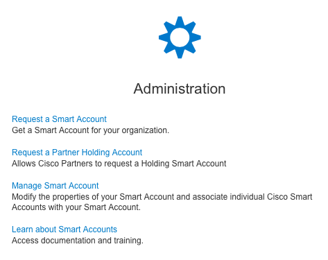<figcaption></figcaption></figure></div>
2.  Select the type of Smart Account to create. There are two options: (a) Individual Smart Account requiring agreement to represent your company. By creating this Smart Account, you agree to authorization to create and manage product and service entitlements, users, and roles on behalf of your organization. (b) Create the account on behalf of someone else.

    <div data-with-frame="true"><figure>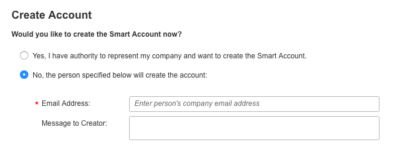<figcaption></figcaption></figure></div>
3.  Provide the required domain identifier and the preferred account name.

    <div data-with-frame="true"><figure>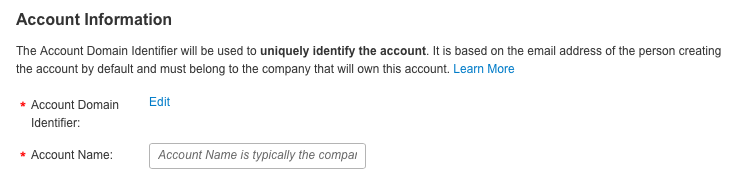<figcaption></figcaption></figure></div>
4.  The account request will be pending approval of the Account Domain Identifier. A subsequent email will be sent to the requester to complete the setup process.

    <div data-with-frame="true"><figure>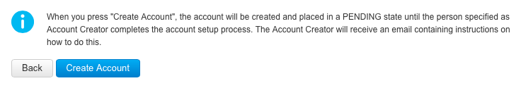<figcaption></figcaption></figure></div>

### Adding Users to a Smart Account <a href="#d5e2905" id="d5e2905"></a>

Smart Account user management is available in the **Administration** section of [Cisco Cisco Software Central](https://software.cisco.com/). Take the following steps to add a new user to a Smart Account:

1.  After logging in Select **Manage Smart Account** in the **Administration** section.

    <div data-with-frame="true"><figure><figcaption></figcaption></figure></div>
2.  Choose the **Users** tab.

    <div data-with-frame="true"><figure>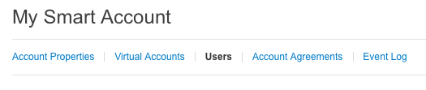<figcaption></figcaption></figure></div>
3.  Select **New User** and follow the instructions in the wizard to add a new user.

    <div data-with-frame="true"><figure>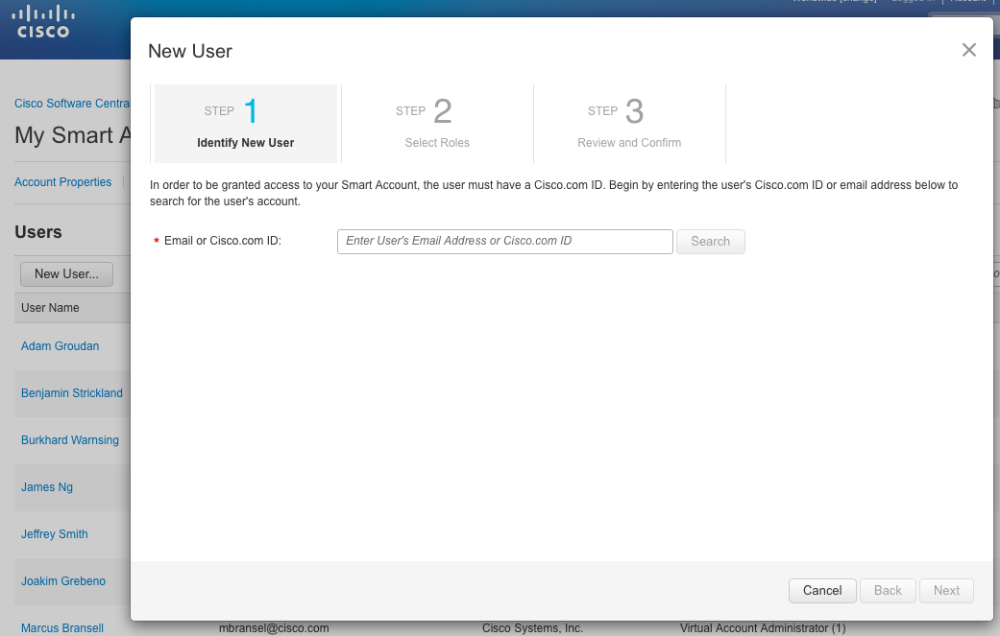<figcaption></figcaption></figure></div>

### Create a License Registration Token <a href="#d5e2927" id="d5e2927"></a>

1.  To create a new token, log into CSSM and select the appropriate Virtual Account.

    <div data-with-frame="true"><figure>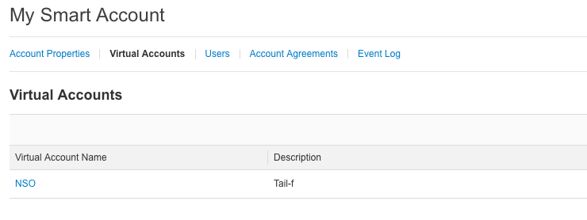<figcaption></figcaption></figure></div>
2.  Click on the **Smart Licenses** link to enter CSSM.

    <div data-with-frame="true"><figure>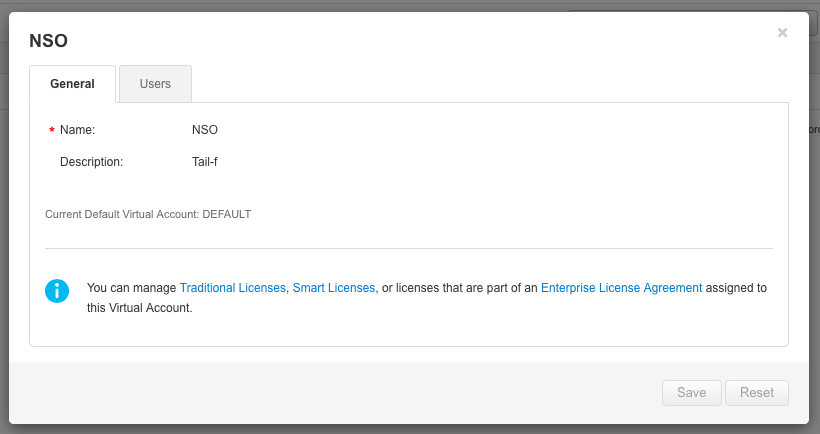<figcaption></figcaption></figure></div>
3.  In CSSM click on **New Token**.

    <div data-with-frame="true"><figure>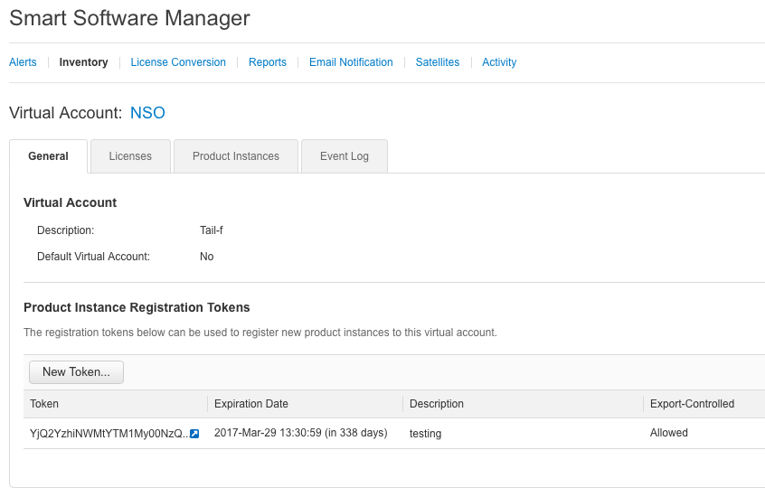<figcaption></figcaption></figure></div>
4.  Follow the dialog to provide a description, expiration, and export compliance applicability before accepting the terms and responsibilities. Click on **Create Token** to continue.

    <div data-with-frame="true"><figure>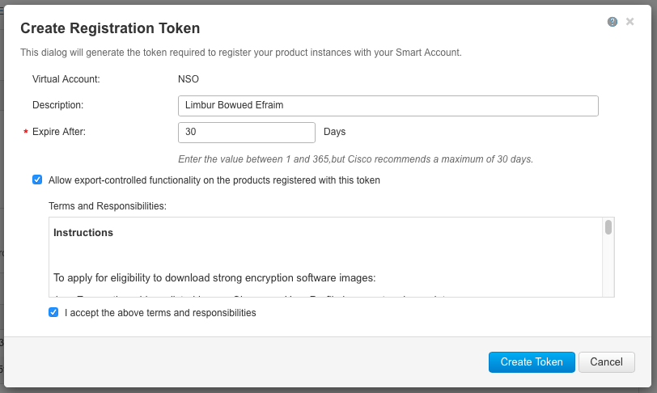<figcaption></figcaption></figure></div>
5.  Click on the new token.

    <div data-with-frame="true"><figure>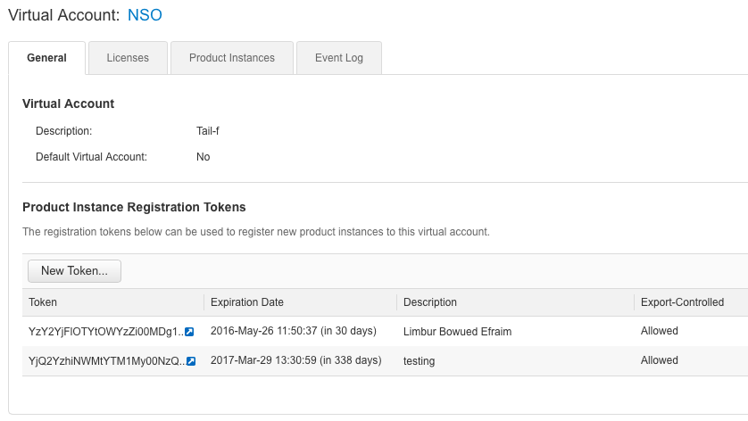<figcaption></figcaption></figure></div>
6.  Copy the token from the dialogue window into your clipboard.

    <div data-with-frame="true"><figure>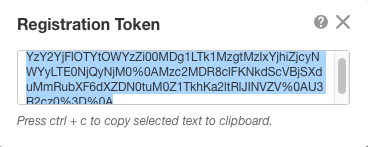<figcaption></figcaption></figure></div>
7.  Go to the NSO CLI and provide the token to the `license smart register idtoken` command:

    ```cli
    admin@ncs# license smart register idtoken YzY2YjFlOTYtOWYzZi00MDg1...
    Registration process in progress.
    Use the 'show license status' command to check the progress and result.
    ```

### Notes on Configuring Smart Licensing <a href="#d5e2966" id="d5e2966"></a>

* If [ncs.conf](../../../resources/man/ncs.conf.5.md) contains configuration for any of java-executable, java-options, override-url/url, or proxy/url under the configure path `/ncs-config/smart-license/smart-agent/` any corresponding configuration done via the CLI is ignored.
*   The smart licensing component of NSO runs its own Java virtual machine. Usually, the default Java options are sufficient:

    ```yang
              leaf java-options {
              tailf:info "Smart licensing Java VM start options";
              type string;
              default "-Xmx64M -Xms16M
              -Djava.security.egd=file:/dev/./urandom";
              description
              "Options which NCS will use when starting
              the Java VM.";}
    ```

    \
    If you, for some reason, need to modify the Java options, remember to include the default values as found in the YANG model.

### Validation and Troubleshooting <a href="#d5e2975" id="d5e2975"></a>

#### Smart Licensing Logging <a href="#smart-licensing-logging" id="smart-licensing-logging"></a>

Smart Licensing events are written to a dedicated log, configured under `/ncs-config/logs/smart-license-log` in [ncs.conf](../../../resources/man/ncs.conf.5.md). This includes Global and Entitlement notifications from the Smart Licensing agent, Java VM start and failure messages, and evaluation countdowns. These events no longer appear in the NSO daemon log (`ncs.log`). Smart Licensing must be enabled for events to be produced.

The shipped [ncs.conf](../../../resources/man/ncs.conf.5.md) enables file output to `smart-license.log` in the NSO log directory. To configure this output, add the following section under `<logs>` in that file:

```xml
<smart-license-log>
  <enabled>true</enabled>
  <log-level>info</log-level>
  <file>
    <enabled>true</enabled>
    <name>${NCS_LOG_DIR}/smart-license.log</name>
    <format>text</format>
  </file>
  <syslog>
    <enabled>false</enabled>
  </syslog>
</smart-license-log>
```

The log is enabled by default in the YANG model, but its file, syslog, and external outputs are disabled by default. The shipped configuration explicitly enables file output. Set `enabled` to `false` to disable the entire log, or `file/enabled` to `false` to disable only its file output.

Set `file/format` to `text` (the default) or `ndjson` to write one JSON object per line. Set `syslog/enabled` to `true` to send messages to syslog. The log also supports `external/enabled` for the [external log handler](../../../development/connected-topics/external-logging.md).

Apply changes with `ncs --reload` on the NSO host. If [ncs.conf](../../../resources/man/ncs.conf.5.md) contains an invalid value, NSO rejects the reload, writes an `ALERT` entry to `ncs.log`, and keeps the previous configuration.


When upgrading from a release before NSO 6.8, the existing [ncs.conf](../../../resources/man/ncs.conf.5.md) is retained. Without a `smart-license-log` destination, Smart Licensing events are no longer recorded in `ncs.log` and are not written to a file or syslog. Add the configuration above, or configure another destination, then run `ncs --reload` on the upgraded instance. Update log collectors, monitoring scripts, and alerting rules to read the Smart Licensing log or receive its syslog output.


NSO does not rotate the Smart Licensing log. Use `logrotate(8)` or a similar tool. If you change the filename or extension, make sure that the rotation configuration includes the file.

The Smart Licensing agent's standard output is captured separately in `ncs-smart-licensing.log`, controlled by `/smart-license/smart-agent/stdout-capture`.

##### Log Levels <a href="#smart-licensing-log-levels" id="smart-licensing-log-levels"></a>

Global and Entitlement notifications have a severity based on their notification type and enforcement mode:

| Condition | Severity |
|-----------|----------|
| Notification type `notifyInvalid`, `notifyRegisterFailed`, `notifyIdCertExpired`, `notifyIdCertRenewFail`, `notifyAuthRenewFailure`, or `notifyCommFailure` | `ERR` |
| Enforcement mode `invalid`, `invalidTag`, `evalExpired`, or `authorizedPeriodExpired` | `ERR` |
| Enforcement mode `outOfCompliance`, `overage`, or `gracePeriod` | `WARNING` |
| All other notifications, such as `notifyRegisterSuccess` or `notifyAuthRenewSuccess` | `INFO` |

The `log-level` setting accepts `fatal`, `alert`, `critical`, `error`, `warn`, `notice`, `info`, `debug`, and `trace`. A message is recorded if its severity is the configured level or more severe. The default `info` records all Smart Licensing messages. To record only warnings and errors, use `<log-level>warn</log-level>`; to record only errors, use `<log-level>error</log-level>`. The configuration value for warnings is `warn`.

Smart Licensing messages are produced only at `ERR`, `WARNING`, and `INFO`. Setting `log-level` to `debug` or `trace` produces the same output as `info`; setting it to `critical`, `alert`, or `fatal` suppresses all Smart Licensing messages. Java VM start, Java VM failure or timeout, and evaluation countdown messages always have severity `INFO`, so a more restrictive level hides them. Evaluation-expired notifications (`evalExpired`) have severity `ERR` and remain visible at `log-level` `error`.

##### Troubleshooting the Log

Check `smart-license.log` first when troubleshooting Smart Licensing. If the log level was raised to reduce volume, set it back to `info` and run `ncs --reload` to see all notifications, including successful registration and authorization renewal. Use the `show license status` command below to check the registration result.

In text output, search for `<ERR>` and `<WARNING>`. In NDJSON output, filter on the `level_name` field for `ERR` and `WARNING`. If a log configuration change does not take effect, check `ncs.log` for an `ALERT` about a rejected configuration reload.

#### Available `show` and `debug` Commands <a href="#d5e2977" id="d5e2977"></a>

* `show license all`: Displays all information.
* `show license status`: Displays status information.
* `show license summary`: Displays summary.
* `show license tech`: Displays license tech support information.
* `show license usage`: Displays usage information.
* `debug smart_lic all`: All available Smart Licensing debug flags.
