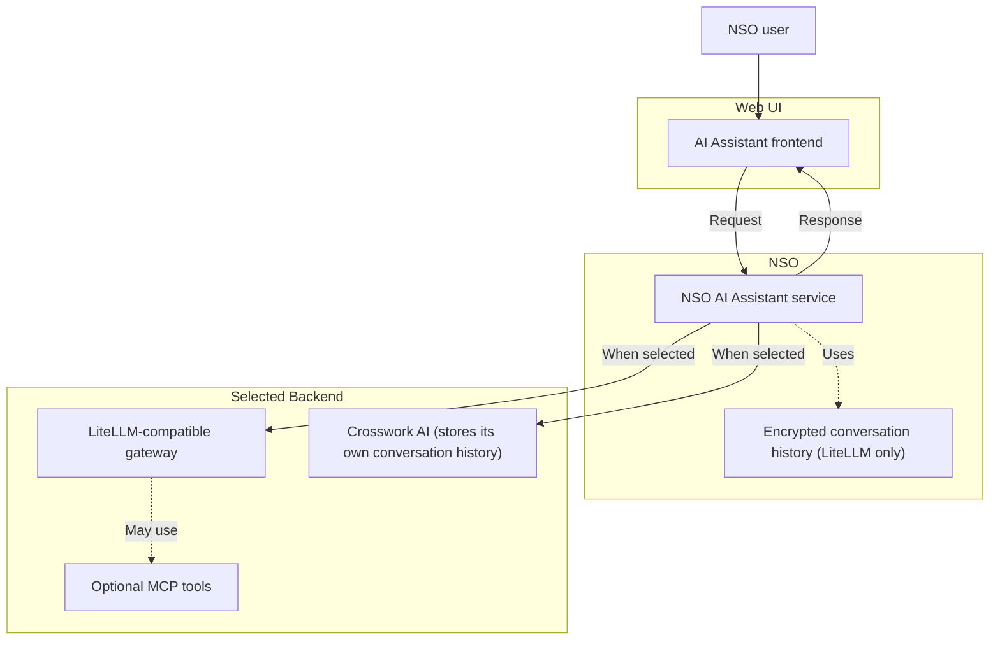

# Web UI AI Assistant

The optional Cisco NSO AI Assistant adds an AI Assistant frontend to the NSO Web UI. An NSO administrator installs and configures the `cisco-nso-ai-assistant` package before users can access the Assistant from the Web UI header.

The AI Assistant frontend sends requests to NSO. NSO then sends the request to the configured AI backend; the browser does not connect directly to an AI gateway, Crosswork AI, or an MCP server.

## Overview

The AI Assistant supports one active backend at a time:

* A LiteLLM-compatible AI gateway. NSO sends conversations to the gateway and stores each NSO user's conversation history locally. This backend can optionally provide the model with tools from Model Context Protocol (MCP) servers. See [Configure Optional MCP Tools](#configure-optional-mcp-tools) for more information.
* A Crosswork AI server. NSO forwards Assistant requests to Crosswork AI, which generates responses and stores the conversation history.

The `active-server` configuration selects the backend for all users. You can configure more than one server and select a different active server when needed.

## Prerequisites

Before enabling the Assistant, make sure that you have:

* An NSO deployment with the Web UI enabled.
* The `cisco-nso-ai-assistant` package installed and loaded. Use the normal [Package Management](package-mgmt.md) workflow for your deployment type.
* One of the following backends:
  * A LiteLLM-compatible gateway. NSO requires its chat-completions, model-information, and token-counting endpoints.
  * A Crosswork AI server.
* An HTTPS connection to a remote AI gateway, Crosswork AI server, or MCP server. HTTP is permitted only for a loopback address such as `localhost` or `127.0.0.1`.

For LiteLLM with MCP tools, the selected model must support OpenAI function calling. MCP is optional; without an enabled and permitted MCP server, the Assistant can still answer questions without tools.

## Request Flow

The browser sends requests to NSO. For the LiteLLM backend, NSO checks the user's permitted MCP access with NACM at the start of each turn, before each model request, and before each MCP exchange. NSO then sends the request to the configured active backend. The LiteLLM backend can use permitted MCP tools and stores encrypted conversation history on the NSO node. Crosswork AI stores its own conversation history.



## Install and Enable the Package

Deploy the package using the same package-management procedure as other NSO packages, and verify that it is running:

```text
admin@ncs# request packages reload
admin@ncs# show packages package cisco-nso-ai-assistant oper-status
```

The package status must be `up` before the Web UI can load the AI Assistant frontend.

All Assistant configuration is under `/ai-assistant:ai-assistant`. Configure an active server before enabling the Assistant. Then enable it and commit the configuration:

```text
configure
set ai-assistant enabled
commit
```

The `enabled` setting controls whether the Assistant button appears in the Web UI. It does not by itself disable the Assistant API. To stop all Assistant requests, remove the `active-server` configuration.

## Configure a LiteLLM-Compatible Gateway

A LiteLLM-compatible gateway gives NSO one API for a model provider. Configure the gateway URL, model alias, gateway key when required, and select the server as active.

```text
configure
set ai-assistant config server local litellm url http://127.0.0.1:4000
set ai-assistant config server local litellm model nso-assistant
set ai-assistant config server local litellm api-key sk-<gateway-key>
set ai-assistant config active-server local
commit
```

Replace the example URL, model alias, and key with values for your gateway. Do not store gateway keys or provider keys in source control. For a remote gateway, configure HTTPS and a trusted certificate.

After the commit, new Assistant requests use the selected server. Requests already in progress can finish with the previously active server.

### Conversation History

For the LiteLLM backend, NSO stores each user's threads and summaries in encrypted local files. The default maximum stored history is 10 MiB per user. You can change the limit, for example:

```text
configure
set ai-assistant config history max-user-size 20
commit
```

When a user's history reaches the configured limit, the user must delete old threads before starting another conversation. NSO does not delete history automatically.


Assistant history is local to each NSO node. Plan history behavior before enabling the LiteLLM backend in a high-availability deployment.


### Configure Optional MCP Tools

Optional MCP tools are available only when the LiteLLM-compatible backend is active.

MCP servers provide tools that the Assistant can offer to the model. NSO connects to the MCP server and performs tool calls; the model and LiteLLM gateway do not receive MCP credentials.

Each MCP server is disabled by default. Configure a Streamable HTTP endpoint, choose an authentication method, enable it, and explicitly allow the tools that NSO may offer.

```text
configure
set ai-assistant config mcp-server local-nso enabled
set ai-assistant config mcp-server local-nso url http://127.0.0.1:8080/mcp
set ai-assistant config mcp-server local-nso authentication nso-user-delegation
set ai-assistant config mcp-server local-nso tool-access read-write
set ai-assistant config mcp-server local-nso allowed-tool nso_read_config
set ai-assistant config mcp-server local-nso allowed-tool nso_read_operational
commit
```

The default `tool-access` mode is `read-only`: NSO offers only tools that the MCP server marks as read-only. Cisco NSO Adaptive MCP marks none of its tools as read-only, so the example uses `read-write`. This mode offers all tools in the `allowed-tool` list, regardless of that marker. Before you enable `read-write`, review the MCP server and restrict `allowed-tool` to the smallest appropriate set.


Enable write-capable MCP tools only when they are required, and restrict the allowed tools to the smallest appropriate set. Write-capable MCP tools, when enabled, can be used by the AI Assistant to make configuration changes. Furthermore, treat Assistant-generated content as guidance, not confirmation that a change was completed. Review the result and use the normal NSO validation and transaction procedures before relying on it.


With `nso-user-delegation`, the MCP server receives a short-lived token for the logged-in NSO user and NACM applies to each tool call. With the other authentication methods, the MCP server sees a shared identity rather than the individual NSO user.

`nso-user-delegation` requires an MCP endpoint on a loopback address with a `/mcp` path. For a remote MCP server, use another supported authentication method. `nso-user-delegation` works only on a single NSO node. In an HA deployment, NSO does not use delegated MCP servers and continues without their tools.

The `mcp-server` list has `nacm:default-deny-all`. Grant users access only to the MCP server entries and tools that they are allowed to use. For more information about the NSO MCP service itself, see [Cisco NSO Adaptive MCP Server](../../development/core-concepts/northbound-apis/nso-mcp-server.md).

## Configure Crosswork AI

To use Crosswork AI instead of LiteLLM, configure a Crosswork AI server, its users, and a mapping from each local NSO user to a Crosswork AI user.

```text
configure
set ai-assistant config server crosswork crosswork-ai url https://<host>
set ai-assistant config server crosswork crosswork-ai user <crosswork-user> password <password>
set ai-assistant config server crosswork crosswork-ai user <crosswork-user> domain <domain>
set ai-assistant config server crosswork crosswork-ai user-map <local-user> crosswork-user <crosswork-user>
set ai-assistant config server crosswork crosswork-ai ca-cert-file <pem-file>
set ai-assistant config active-server crosswork
commit
```

Crosswork AI uses HTTPS. Configure a CA certificate file when its certificate is signed by a private CA. Do not disable certificate verification in production.

Each local NSO user who uses this backend needs a `user-map` entry. The local user must be defined in `/aaa/authentication/users`; users authenticated through PAM, LDAP, RADIUS, external authentication, or package authentication cannot be mapped to Crosswork AI. Several NSO users can map to the same Crosswork AI user, but they then share that user's Crosswork AI threads.

When Crosswork AI is active, NSO forwards the conversation to Crosswork AI. NSO does not use LiteLLM settings, MCP servers, delegated MCP access, or locally stored Assistant history for that conversation.

## Control Web UI Access

The Web UI reads `/ai-assistant:ai-assistant/enabled` to determine whether to display the AI Assistant button. The Assistant **Settings** > **Server** tab also reads `config/active-server` and configured server names. If your NACM policy uses `read-default deny`, grant users read access to those nodes. Grant write access to `config/active-server` only to users allowed to change the active server.

Protect credentials, Crosswork AI users and user mappings, and MCP configuration as administrator-only data. NSO rechecks a user's permitted MCP server access when a turn begins, before model requests, and before MCP exchanges. Removing access prevents subsequent tool use.

## Use the Assistant in the Web UI

When the AI Assistant is enabled, users can click the AI Assistant button in the Web UI header to open or close the Assistant. The Assistant **Settings** menu includes a **Server** tab where users with write access can select an available configured server. Restrict write access to `config/active-server` if only administrators should change the active server.

Users should validate Assistant responses and any configuration effects through the normal NSO interfaces. A model response, including one that reports a successful tool call, is not a substitute for reviewing the resulting transaction or operational state.

## Monitor and Troubleshoot

Use `devel.log` for Assistant backend and configuration errors. NSO writes an entry to `audit.log` for each MCP tool call and each MCP server failure. The audit entry identifies the user, server, tool, outcome, and trace ID, but does not contain prompts, tool arguments, tool results, or credentials.

Common administrator checks are:

* Verify that `cisco-nso-ai-assistant` has package status `up`.
* Verify that an active server is configured and reachable.
* Verify the gateway URL, model alias, certificate trust, and gateway key for LiteLLM.
* Verify local AAA user mappings and certificate trust for Crosswork AI.
* Verify NACM access, MCP server status, and the `allowed-tool` list for tool-related failures.
* Check the configured history limit when users report that their chat history is full.

## Current Scope

The Assistant provides chat, configurable AI backends, optional MCP tools, per-user access enforcement, and audit logging. Continue to use the normal Web UI transaction, validation, and commit workflow for configuration changes.
