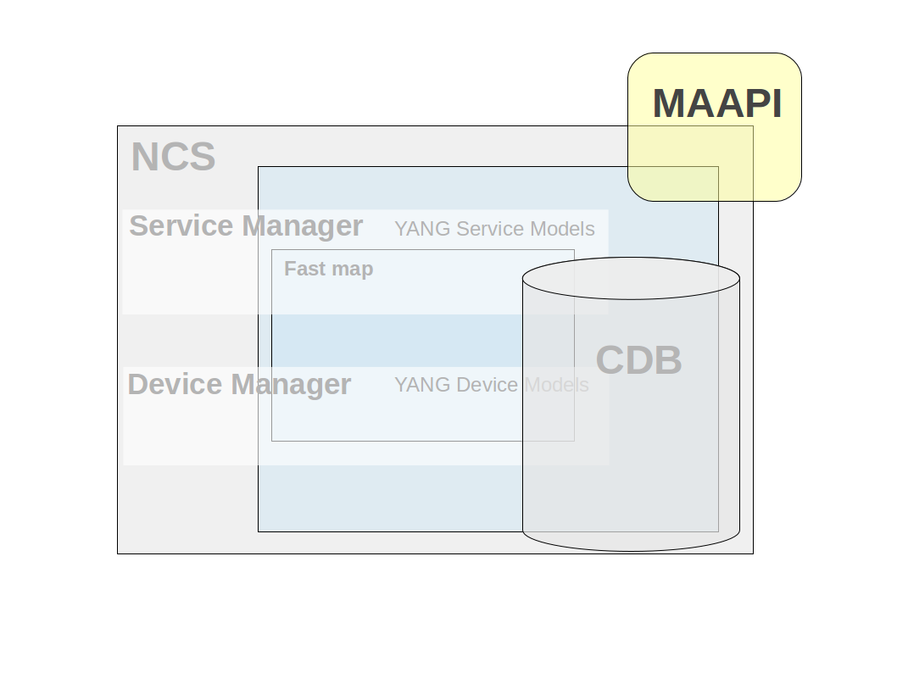
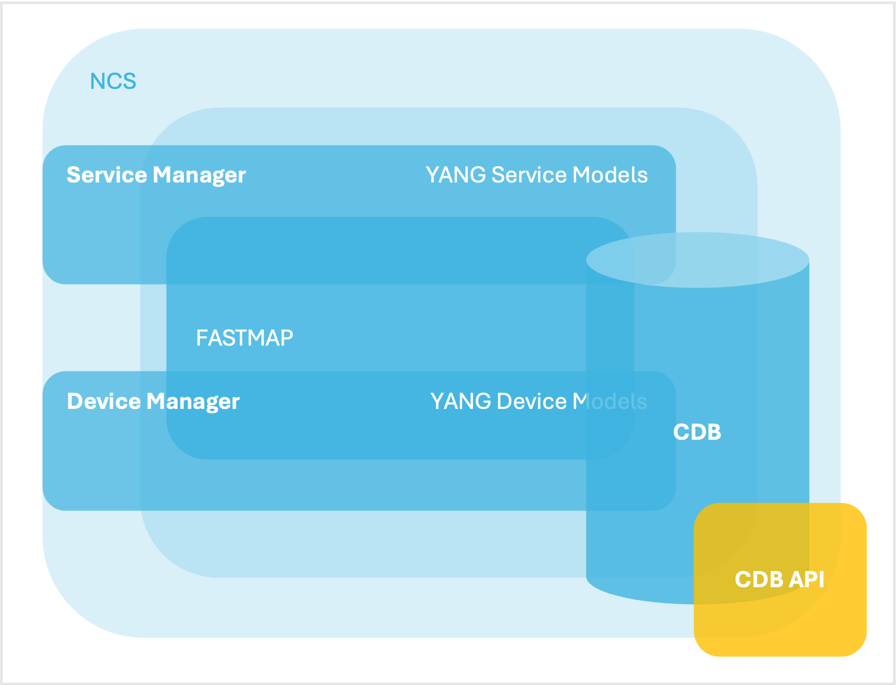
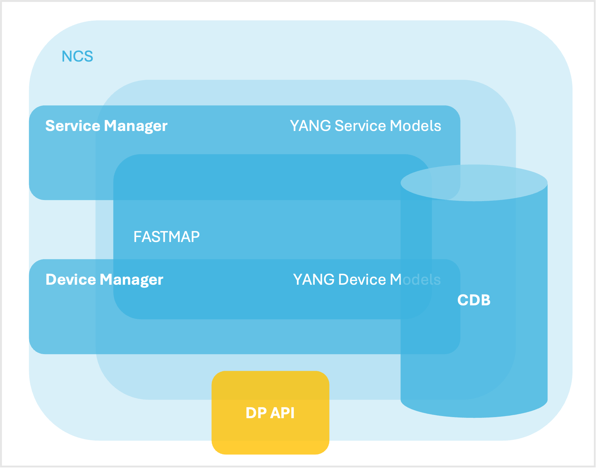
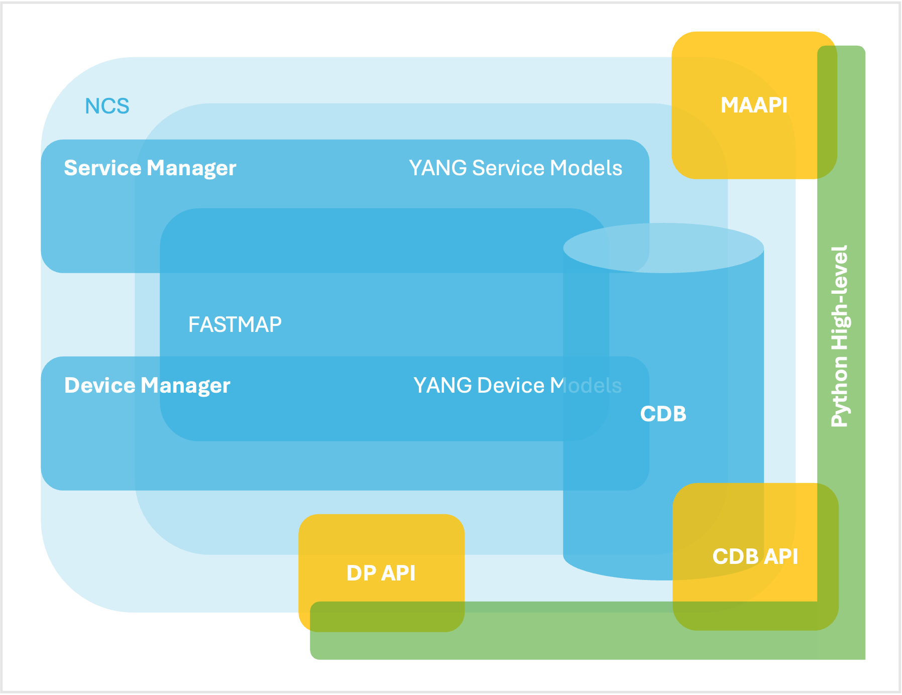

# Python API Overview

The NSO Python library contains a variety of APIs for different purposes. In this section, we introduce these and explain their usage. The NSO Python module deliverables are found in two variants, the low-level APIs and the high-level APIs.

The low-level APIs are a direct mapping of the NSO C APIs, CDB, and MAAPI. These will follow the evolution of the C APIs. See `man confd_lib_lib` for further information.

The high-level APIs are an abstraction layer on top of the low-level APIs to make them easier to use and to improve code readability and development rate for common use cases. E.g. services and action callbacks and common scripting towards NSO.

## Python API Overview <a href="#d5e4354" id="d5e4354"></a>

<table data-header-hidden data-full-width="false"><thead><tr><th width="350"></th><th></th></tr></thead><tbody><tr><td><strong>MAAPI (Management Agent API)</strong><br>Northbound interface that is transactional and user session-based. Using this interface, both configuration and operational data can be read. Configuration and operational data can be written and committed as one transaction. The API is complete in the way that it is possible to write a new northbound agent using only this interface. It is also possible to attach to ongoing transactions to read uncommitted changes and/or modify data in these transactions.</td><td></td></tr><tr><td><strong>Python low-level CDB API</strong><br>The Southbound interface provides access to the CDB configuration database. Using this interface, configuration data can be read. In addition, operational data that is stored in CDB can be read and written. This interface has a subscription mechanism to subscribe to changes. A subscription is specified on a path that points to an element in a YANG model or an instance in the instance tree. Any change under this point will trigger the subscription. CDB also has functions to iterate through the configuration changes when a subscription has been triggered.</td><td></td></tr><tr><td><strong>Python low-level DP API</strong><br>Southbound interface that enables callbacks, hooks, and transforms. This API makes it possible to provide the service callbacks that handle service-to-device mapping logic. Other usual cases are external data providers for operational data or action callback implementations. There are also transaction and validation callbacks, etc. Hooks are callbacks that are fired when certain data is written and the hook is expected to do additional modifications of data. Transforms are callbacks that are used when complete mediation between two different models is necessary.</td><td></td></tr><tr><td><strong>Python high-level API</strong>: API that resides on top of the MAAPI, CDB, and DP APIs. It provides schema model navigation and instance data handling (read/write). Uses a MAAPI context as data access and incorporates its functionality. It is used in service implementations, action handlers, and Python scripting.</td><td></td></tr></tbody></table>

## Python scripting <a href="#d5e4389" id="d5e4389"></a>

Scripting in Python is a very easy and powerful way of accessing NSO. This document has several examples of scripts showing various ways of accessing data and requesting actions in NSO.

The examples are directly executable with the Python interpreter after sourcing the `ncsrc` file in the NSO installation directory. This sets up the `PYTHONPATH` environment variable, which enables access to the NSO Python modules.

Edit a file and execute it directly on the command line like this:

```bash
$ python3 script.py
```

## High-level MAAPI API <a href="#d5e4398" id="d5e4398"></a>

The Python high-level MAAPI API provides an easy-to-use interface for accessing NSO. Its main targets are to encapsulate the sockets, transaction handles, data type conversions, and the possibility of using the Python `with` statement for proper resource cleanup.

The simplest way to access NSO is to use the `single_transaction` helper. It creates a MAAPI context and a transaction in one step.

This example shows its usage, connecting as user `admin` and `python` in the AAA context:


```python
import ncs

with ncs.maapi.single_write_trans('admin', 'python') as t:
    t.set_elem2('Kilroy was here', '/ncs:devices/device{ce0}/description')
    t.apply()

with ncs.maapi.single_read_trans('admin', 'python') as t:
    desc = t.get_elem('/ncs:devices/device{ce0}/description')
    print("Description for device ce0 = %s" % desc)
```



The example code here shows how to start a transaction but does not properly handle the case of concurrency conflicts when writing data. See [Handling Conflicts](../nso-concurrency-model.md#ncs.development.concurrency.handling) for details.



When only reading data, always start a `read` transaction to read directly from the CDB datastore and data providers. `write` transactions cache repeated reads done by the same transaction.


A common use case is to create a MAAPI context and reuse it for several transactions. This reduces the latency and increases the transaction throughput, especially for backend applications. For scripting the lifetime is shorter and there is no need to keep the MAAPI contexts alive.

This example shows how to keep a MAAPI connection alive between transactions:


```python
import ncs

with ncs.maapi.Maapi() as m:
    with ncs.maapi.Session(m, 'admin', 'python'):

        # The first transaction
        with m.start_read_trans() as t:
            address = t.get_elem('/ncs:devices/device{ce0}/address')
            print("First read: Address = %s" % address)

        # The second transaction
        with m.start_read_trans() as t:
            address = t.get_elem('/ncs:devices/device{ce1}/address')
            print("Second read: Address = %s" % address)
```


## Maagic API

Maagic is a module provided as part of the NSO Python APIs. It reduces the complexity of programming towards NSO, is used on top of the MAAPI high-level API, and addresses areas that require more programming. First, it helps in navigating the model, using standard Python object dot notation, giving very clear and easily read code. The context handlers remove the need to close sockets, user sessions, and transactions and the problems when they are forgotten and kept open. Finally, it removes the need to know the data types of the leafs, helping you to focus on the data to be set.

When using Maagic, you still do the same procedure of starting a transaction.

```python
with ncs.maapi.Maapi() as m:
  with ncs.maapi.Session(m, 'admin', 'python'):
    with m.start_write_trans() as t:
      # Read/write/request ...
```

To use the Maagic functionality, you get access to a Maagic object either pointing to the root of the CDB:

```
root = ncs.maagic.get_root(t)
```

In this case, it is a `ncs.maagic.Node` object with a `ncs.maapi.Transaction` backend.

From here, you can navigate in the model. In the table, you can see examples of how to navigate.

The table below lists Maagic object navigation.

| Action                                       | Returns             |
| -------------------------------------------- | ------------------- |
| `root.devices`                               | `Container`         |
| `root.devices.device`                        | `List`              |
| `root.devices.device['ce0']`                 | `ListElement`       |
| `root.devices.device['ce0'].device_type.cli` | `PresenceContainer` |
| `root.devices.device['ce0'].address`         | `str`               |
| `root.devices.device['ce0'].port`            | `int`               |

You can also get a Maagic object from a keypath:

```
node = ncs.maagic.get_node(t, '/ncs:devices/device{ce0}')
```

### Namespaces <a href="#d5e4469" id="d5e4469"></a>

Maagic handles namespaces by a prefix to the names of the elements. This is optional but recommended to avoid future side effects.

The syntax is to prefix the names with the namespace name followed by two underscores, e.g., `ns_name__ name`.

Examples of how to use namespaces:

```bash
# The examples are equal unless there is a namespace collision.
# For the ncs namespace it would look like this:

root.ncs__devices.ncs__device['ce0'].ncs__address
# equals
root.devices.device['ce0'].address
```

In cases where there is a name collision, the namespace prefix is required to access an entity from a module, except for the module that was first loaded. A namespace is always required for root entities when there is a collision. The module load order is found in the NCS log file: `logs/ncs.log`.

```bash
# This example have three namespaces referring to a leaf, value, with the same
# name and this load order: /ex/a:value=11, /ex/b:value=22 and /ex/c:value=33

root.ex.value # returns 11
root.ex.a__value # returns 11
root.ex.b__value # returns 22
root.ex.c__value # returns 33
```

### Reading Data <a href="#d5e4480" id="d5e4480"></a>

Reading data using Maagic is straightforward. You will just specify the leaf you are interested in and the data is retrieved. The data is returned in the nearest available Python data type.

For non-existing leafs, `None` is returned.

```
dev_name = root.devices.device['ce0'].name # 'ce0'
dev_address = root.devices.device['ce0'].address # '127.0.0.1'
dev_port = root.devices.device['ce0'].port # 10022
```

### Writing Data <a href="#d5e4486" id="d5e4486"></a>

Writing data using Maagic is straightforward. You will just specify the leaf you are interested in and assign a value. Any data type can sent as input, as the `str` function is called, converting it to a string. The format depends on the data type. If the type validation fails, an `Error` exception is thrown.

```
root.devices.device['ce0'].name  = 'ce0'
root.devices.device['ce0'].address  = '127.0.0.1'
root.devices.device['ce0'].port = 10022
root.devices.device['ce0'].port = '10022' # Also valid

# This will raise an Error exception
root.devices.device['ce0'].port = 'netconf'
```

### Deleting Data <a href="#d5e4492" id="d5e4492"></a>

Data is deleted the Python way of using the `del` function:

```
del root.devices.device['ce0'] # List element
del root.devices.device['ce0'].name # Leaf
del root.devices.device['ce0'].device_type.cli # Presence container
```

Some entities have a delete method, this is explained under the corresponding type.

### Object Deletion

The delete mechanism in Maagic is implemented using the `__delattr__` method on the `Node` class. This means that executing the del function on a local or global variable will only delete the object from the Python local or global namespaces. E.g., `del obj`.

### Containers <a href="#d5e4504" id="d5e4504"></a>

Containers are addressed using standard Python dot notation: `root.container1.container2`.

### Presence Containers <a href="#d5e4508" id="d5e4508"></a>

A presence container is created using the `create` method:

```
pc = root.container.presence_container.create()
```

Existence is checked with the `exists` or `bool` functions:

```
root.container.presence_container.exists() # Returns True or False
bool(root.container.presence_container) # Returns True or False
```

A presence container is deleted with the `del` or `delete` functions:

```
del root.container.presence_container
root.container.presence_container.delete()
```

### Choices <a href="#d5e4516" id="d5e4516"></a>

The case of a choice is checked by addressing the name of the choice in the model:

```
ne_type = root.devices.device['ce0'].device_type.ne_type
if ne_type == 'cli':
  # Handle CLI
elif ne_type == 'netconf':
  # Handle NETCONF
elif ne_type == 'generic':
  # Handle generic
else:
  # Don't handle
```

Changing a choice is done by setting a value in any of the other cases:

```
root.devices.device['ce0'].device_type.netconf.create()
str(root.devices.device['ce0'].device_type.ne_type) # Returns 'netconf'
```

### Lists and List Elements <a href="#d5e4522" id="d5e4522"></a>

List elements are created using the create method on the `List` class:

```bash
# Single value key
ce5 = root.devices.device.create('ce5')

# Multiple values key
o = root.container.list.create('foo', 'bar')
```

The objects `ce5` and _`o`_ above are of type `ListElement` which is actually an ordinary `container` object with a different name.

Existence is checked with the `exists` or `bool` functions `List` class:

```
'ce0' in root.devices.device # Returns True or False
```

A list element is deleted with the Python `del` function:

```bash
# Single value key
del root.devices.device['ce5']

# Multiple values key
del root.container.list['foo', 'bar']
```

To delete the whole list, use the Python `del` function or `delete()` on the list.

```bash
# use Python's del function
del root.devices.device

# use List's delete() method
root.container.list.delete()
```

### Unions <a href="#d5e4539" id="d5e4539"></a>

Unions are not handled in any specific way - you just read or write to the leaf and the data is validated according to the model.

### Enumeration <a href="#d5e4542" id="d5e4542"></a>

Enumerations are returned as an `Enum` object, giving access to both the integer and string values.

```
str(root.devices.device['ce0'].state.admin_state) # May return 'unlocked'
root.devices.device['ce0'].state.admin_state.string # May return 'unlocked'
root.devices.device['ce0'].state.admin_state.value # May return 1
```

Writing values to enumerations accepts both the string and integer values.

```
root.devices.device['ce0'].state.admin_state = 'locked'
root.devices.device['ce0'].state.admin_state = 0

# This will raise an Error exception
root.devices.device['ce0'].state.admin_state = 3 # Not a valid enum
```

### Leafref <a href="#d5e4549" id="d5e4549"></a>

Leafrefs are read as regular leafs and the returned data type corresponds to the referred leaf.

```bash
# /model/device is a leafref to /devices/device/name

dev = root.model.device # May return 'ce0'
```

Leafrefs are set as the leaf they refer to. The data type is validated as it is set. The reference is validated when the transaction is committed.

```bash
# /model/device is a leafref to /devices/device/name

root.model.device = 'ce0'
```

### Identityref <a href="#d5e4555" id="d5e4555"></a>

Identityrefs are read and written as string values. Writing an identityref without a prefix is possible, but doing so is error-prone and may stop working if another model is added which also has an identity with the same name. The recommendation is to always use a prefix when writing identityrefs. Reading an identityref will always return a prefixed string value.

```bash
# Read
root.devices.device['ce0'].device_type.cli.ned_id # May return 'ios-id:cisco-ios'

# Write when identity cisco-ios is unique throughout the system (not recommended)
root.devices.device['ce0'].device_type.cli.ned_id = 'cisco-ios'

# Write with unique identity
root.devices.device['ce0'].device_type.cli.ned_id = 'ios-id:cisco-ios'
```

### Instance Identifier <a href="#d5e4559" id="d5e4559"></a>

Instance identifiers are read as xpath formatted string values.

```bash
# /model/iref is an instance-identifier

root.model.iref # May return "/ncs:devices/ncs:device[ncs:name='ce0']"
```

Instance identifiers are set as xpath formatted strings. The string is validated as it is set. The reference is validated when the transaction is committed.

```bash
# /model/iref is an instance-identifier

root.devices.device['ce0'].device_type.cli.ned_id = "/ncs:devices/ncs:device[ncs:name='ce0']"
```

### Leaf-list <a href="#d5e4565" id="d5e4565"></a>

A leaf-list is represented by a `LeafList` object. This object behaves very much like a Python list. You may iterate it, check for the existence of a specific element using `in`, or remove specific items using the `del` operator. See examples below.


From NSO version 4.5 and onwards, a Yang leaf-list is represented differently than before. Reading a leaf-list using Maagic used to result in an ordinary Python list (or None if the leaf-list was non-existent). Now, reading a leaf-list will give back a `LeafList` object whether it exists or not. The `LeafList` object may be iterated like a Python list and you may check for existence using the `exists()` method or the `bool()` operator. A Maagic leaf-list node may be assigned using a Python list, just like before, and you may convert it to a Python list using the `as_list()` method or by doing `list(my_leaf_list_node)`.


```bash
# /model/ll is a leaf-list with the type string

# read a LeafList object
ll = root.model.ll

# iteration
for item in root.model.ll:
    do_stuff(item)

# check if the leaf-list exists (i.e. is non-empty)
if root.model.ll:
    do_stuff()
if root.model.ll.exists():
    do_stuff()

# check the leaf-list contains a specific item
if 'foo' in root.model.ll:
    do_stuff()

# length
len(root.model.ll)

# create a new item in the leaf-list
root.model.ll.create('bar')

# set the whole leaf-list in one operation
root.model.ll = ['foo', 'bar', 'baz']

# remove a specific item from the list
del root.model.ll['bar']
root.model.ll.remove('baz')

# delete the whole leaf-list
del root.model.ll
root.model.ll.delete()

# get the leaf-list as a Python list
root.model.ll.as_list()
```

### Binary <a href="#d5e4581" id="d5e4581"></a>

Binary values are read and written as byte strings.

```bash
# Read
root.model.bin # May return '\x00foo\x01bar'

# Write
root.model.bin = b'\x00foo\x01bar'
```

### Bits <a href="#d5e4585" id="d5e4585"></a>

Reading a `bits` leaf will give a Bits object back (or None if the `bits` leaf is non-existent). To get some useful information out of the Bits object, you can either use the `bytearray()` method to get a Python byte array object in return or the Python `str()` operator to get a space-separated string containing the bit names.

```bash
# read a bits leaf - a Bits object may be returned (None if non-existent)
root.model.bits

# get a bytearray
root.model.bits.bytearray()

# get a space separated string with bit names
str(root.model.bits)
```

There are four ways of setting a `bits` leaf: One is to set it using a string with space-separated bit names, the other one is to set it using a byte array, the third by using a Python binary string, and as a last option is it may be set using a Bits object. Note that updating a Bits object does not change anything in the database - for that to happen, you need to assign it to the Maagic node.

```bash
# set a bits leaf using a string of space separated bit names
root.model.bits = 'turboMode enableEncryption'

# set a bits leaf using a Python bytearray
root.model.bits = bytearray(b'\x11')

# set a bits leaf using a Python binary string
root.model.bits = b'\x11'

# read a bits leaf, update the Bits object and set it
b = x.model.bits
b.clr_bit(0)
x.model.bits = b
```

### Empty Leaf <a href="#d5e4591" id="d5e4591"></a>

An empty leaf is created using the `create` method. If the type empty leaf is part of a union, the leaf must be set to the `C_EMPTY` value instead.

```
pc = root.container.empty_leaf.create()
```

If the type empty leaf is part of a union, then you read the leaf to see if `empty` is the current value. Otherwise, existence is checked with the `exists` or `bool` functions:

```
root.container.empty_leaf.exists() # Returns True or False
bool(root.container.empty_leaf) # Returns True or False
```

An empty leaf is deleted with the `del` or `delete` functions:

```
del root.container.empty_leaf
root.container.empty_leaf.delete()
```

## Maagic Examples <a href="#d5e4599" id="d5e4599"></a>

### Action Requests <a href="#d5e4601" id="d5e4601"></a>

Requesting an action may not require an ongoing transaction and this example shows how to use Maapi as a transactionless back-end for Maagic.


```python
import ncs

with ncs.maapi.Maapi() as m:
    with ncs.maapi.Session(m, 'admin', 'python'):
        root = ncs.maagic.get_root(m)

        output = root.devices.check_sync()

        for result in output.sync_result:
            print('sync-result {')
            print('    device %s' % result.device)
            print('    result %s' % result.result)
            print('}')
```


This example shows how to request an action that requires an ongoing transaction. It is also valid to request an action that does not require an ongoing transaction.


```python
import ncs

with ncs.maapi.Maapi() as m:
    with ncs.maapi.Session(m, 'admin', 'python'):
        with m.start_read_trans() as t:
            root = ncs.maagic.get_root(t)

            output = root.devices.check_sync()

            for result in output.sync_result:
                print('sync-result {')
                print('    device %s' % result.device)
                print('    result %s' % result.result)
                print('}')
```


Providing parameters to an action with Maagic is very easy: You request an input object, with `get_input` from the Maagic action object, and set the desired (or required) parameters as defined in the model specification.


```python
import ncs

with ncs.maapi.Maapi() as m:
    with ncs.maapi.Session(m, 'admin', 'python'):
        root = ncs.maagic.get_root(m)

        input = root.action.double.get_input()
        input.number = 21
        output = root.action.double(input)

        print(output.result)
```


If you have a leaf-list, you need to prepare the input parameters


```python
import ncs

with ncs.maapi.Maapi() as m:
    with ncs.maapi.Session(m, 'admin', 'python'):
        root = ncs.maagic.get_root(m)

        input = root.leaf_list_action.llist.get_input()
        input.args = ['testing action']
        output = root.leaf_list_action.llist(input)

        print(output.result)
```


A common use case is to script the creation of devices. With the Python APIs, this is easily done without the need to generate set commands and execute them in the CLI.


```python
import argparse
import ncs


def parseArgs():
    parser = argparse.ArgumentParser()
    parser.add_argument('--name', help="device name", required=True)
    parser.add_argument('--address', help="device address", required=True)
    parser.add_argument('--port', help="device address", type=int, default=22)
    parser.add_argument('--desc', help="device description",
                        default="Device created by maagic_create_device.py")
    parser.add_argument('--auth', help="device authgroup", default="default")
    return parser.parse_args()


def main(args):
    with ncs.maapi.Maapi() as m:
        with ncs.maapi.Session(m, 'admin', 'python'):
            with m.start_write_trans() as t:
                root = ncs.maagic.get_root(t)

                print("Setting device '%s' configuration..." % args.name)

                # Get a reference to the device list
                device_list = root.devices.device

                device = device_list.create(args.name)
                device.address = args.address
                device.port = args.port
                device.description = args.desc
                device.authgroup = args.auth
                dev_type = device.device_type.cli
                dev_type.ned_id = 'cisco-ios-cli-3.0'
                device.state.admin_state = 'unlocked'

                print('Committing the device configuration...')
                t.apply()
                print("Committed")

                # This transaction is no longer valid

            #
            # fetch-host-keys and sync-from does not require a transaction
            # continue using the Maapi object
            #
            root = ncs.maagic.get_root(m)
            device = root.devices.device[args.name]

            print("Fetching SSH keys...")
            output = device.ssh.fetch_host_keys()
            print("Result: %s" % output.result)

            print("Syncing configuration...")
            output = device.sync_from()
            print("Result: %s" % output.result)
            if not output.result:
                print("Error: %s" % output.info)


if __name__ == '__main__':
    main(parseArgs())
```


## PlanComponent

This class is a helper to support service progress reporting using `plan-data` as part of a Reactive FASTMAP nano service. More info about `plan-data` is found in [Nano Services for Staged Provisioning](../nano-services.md).

The interface of the `PlanComponent` is identical to the corresponding Java class and supports the setup of plans and setting the transition states.

```python
class PlanComponent(object):
    """Service plan component.

    The usage of this class is in conjunction with a nano service that
    uses a reactive FASTMAP pattern.
    With a plan the service states can be tracked and controlled.

    A service plan can consist of many PlanComponent's.
    This is operational data that is stored together with the service
    configuration.
    """

    def __init__(self, service, name, component_type):
        """Initialize a PlanComponent."""

    def append_state(self, state_name):
        """Append a new state to this plan component.

        The state status will be initialized to 'ncs:not-reached'.
        """

    def set_reached(self, state_name):
        """Set state status to 'ncs:reached'."""

    def set_failed(self, state_name):
        """Set state status to 'ncs:failed'."""

    def set_status(self, state_name, status):
        """Set state status."""
```

See `pydoc3 ncs.application.PlanComponent` for further information about the Python class.

The pattern is to add an overall plan (self) for the service and separate plans for each component that builds the service.

```
self_plan = PlanComponent(service, 'self', 'ncs:self')
self_plan.append_state('ncs:init')
self_plan.append_state('ncs:ready')
self_plan.set_reached('ncs:init')

route_plan = PlanComponent(service, 'router', 'myserv:router')
route_plan.append_state('ncs:init')
route_plan.append_state('myserv:syslog-initialized')
route_plan.append_state('myserv:ntp-initialized')
route_plan.append_state('myserv:dns-initialized')
route_plan.append_state('ncs:ready')
route_plan.set_reached('ncs:init')
```

When appending a new state to a plan the initial state is set to `ncs:not-reached`. At the completion of a plan the state is set to `ncs:ready`. In this case when the service is completely setup:

```
self_plan.set_reached('ncs:ready')
```

## Python Packages <a href="#d5e4639" id="d5e4639"></a>

### Action Handler <a href="#d5e4641" id="d5e4641"></a>

The Python high-level API provides an easy way to implement an action handler for your modeled actions. The easiest way to create a handler is to use the `ncs-make-package` command. It creates some ready-to-use skeleton code.

```bash
$ cd packages
$ ncs-make-package --service-skeleton python pyaction --component-class
 action.Action \
 --action-example
```

The generated package skeleton:

```bash
$ tree pyaction
pyaction/
+-- README
+-- doc/
+-- load-dir/
+-- package-meta-data.xml
+-- python/
|   +-- pyaction/
|       +-- __init__.py
|       +-- action.py
+-- src/
|   +-- Makefile
|   +-- yang/
|       +-- action.yang
+-- templates/
```

This example action handler takes a number as input, doubles it, and returns the result.

When debugging Python packages refer to [Debugging of Python Packages](../nso-virtual-machines/nso-python-vm.md#debugging-of-python-packages).


```bash
# -*- mode: python; python-indent: 4 -*-

from ncs.application import Application
from ncs.dp import Action

# ---------------
# ACTIONS EXAMPLE
# ---------------
class DoubleAction(Action):
    @Action.action
    def cb_action(self, uinfo, name, kp, input, output):
        self.log.info('action name: ', name)
        self.log.info('action input.number: ', input.number)

        output.result = input.number * 2

class LeafListAction(Action):
    @Action.action
    def cb_action(self, uinfo, name, kp, input, output):
        self.log.info('action name: ', name)
        self.log.info('action input.args: ', input.args)
        output.result = [ w.upper() for w in input.args]

# ---------------------------------------------
# COMPONENT THREAD THAT WILL BE STARTED BY NCS.
# ---------------------------------------------
class Action(Application):
    def setup(self):
        self.log.info('Worker RUNNING')
        self.register_action('action-action', DoubleAction)
        self.register_action('llist-action', LeafListAction)

    def teardown(self):
        self.log.info('Worker FINISHED')
```


Test the action by doing a request from the NSO CLI:

```
admin@ncs> request action double number 21
result 42
[ok][2016-04-22 10:30:39]
```

The input and output parameters are the most commonly used parameters of the action callback method. They provide the access objects to the data provided to the action request and the returning result.

They are `maagic.Node` objects, which provide easy access to the modeled parameters.

The table below lists the action handler callback parameters:

<table><thead><tr><th width="141">Parameter</th><th width="201">Type</th><th>Description</th></tr></thead><tbody><tr><td><code>self</code></td><td><code>ncs.dp.Action</code></td><td>The action object.</td></tr><tr><td><code>uinfo</code></td><td><code>ncs.UserInfo</code></td><td>User information of the requester.</td></tr><tr><td><code>name</code></td><td><code>string</code></td><td>The tailf:action name.</td></tr><tr><td><code>kp</code></td><td><code>ncs.HKeypathRef</code></td><td>The keypath of the action.</td></tr><tr><td><code>input</code></td><td><code>ncs.maagic.Node</code></td><td>An object containing the parameters of the input section of the action yang model.</td></tr><tr><td><code>output</code></td><td><code>ncs.maagic.Node</code></td><td>The object where to put the output parameters as defined in the output section of the action yang model.</td></tr></tbody></table>

To fail an action with an error code, an `error-app-tag`, or `error-info`, raise `CallbackError`. See [Errors That Callbacks Report](python-api-overview.md#callback-errors).

### Service Handler

The Python high-level API provides an easy way to implement a service handler for your modeled services. The easiest way to create a handler is to use the `ncs-make-package` command. It creates some skeleton code.

```bash
$ cd packages
$ ncs-make-package --service-skeleton python pyservice \
 --component-class service.Service
```

The generated package skeleton:

```bash
$ tree pyservice
pyservice/
+-- README
+-- doc/
+-- load-dir/
+-- package-meta-data.xml
+-- python/
|   +-- pyservice/
|       +-- __init__.py
|       +-- service.py
+-- src/
|   +-- Makefile
|   +-- yang/
|       +-- service.yang
+-- templates/
```

This example has some code added for the service logic, including a service template.

When debugging Python packages, refer to [Debugging of Python Packages](../nso-virtual-machines/nso-python-vm.md#debugging-of-python-packages).

Add some service logic to the `cb_create`:


```bash
# -*- mode: python; python-indent: 4 -*-

from ncs.application import Application
from ncs.application import Service
import ncs.template

# ------------------------
# SERVICE CALLBACK EXAMPLE
# ------------------------
class ServiceCallbacks(Service):
    @Service.create
    def cb_create(self, tctx, root, service, proplist):
        self.log.info('Service create(service=', service._path, ')')

        # Add this service logic >>>>>>>
        vars = ncs.template.Variables()
        vars.add('MAGIC', '42')
        vars.add('CE', service.device)
        vars.add('INTERFACE', service.unit)
        template = ncs.template.Template(service)
        template.apply('pyservice-template', vars)

        self.log.info('Template is applied')

        dev = root.devices.device[service.device]
        dev.description = "This device was modified by %s" % service._path
        # <<<<<<<<< service logic

    @Service.pre_modification
    def cb_pre_modification(self, tctx, op, kp, root, proplist):
        self.log.info('Service premod(service=', kp, ')')

    @Service.post_modification
    def cb_post_modification(self, tctx, op, kp, root, proplist):
        self.log.info('Service premod(service=', kp, ')')


# ---------------------------------------------
# COMPONENT THREAD THAT WILL BE STARTED BY NCS.
# ---------------------------------------------
class Service(Application):
    def setup(self):
        self.log.info('Worker RUNNING')
        self.register_service('service-servicepoint', ServiceCallbacks)

    def teardown(self):
        self.log.info('Worker FINISHED')
```


Add a template to `packages/pyservice/templates/service.template.xml`:

```xml
<config-template xmlns="http://tail-f.com/ns/config/1.0">
  <devices xmlns="http://tail-f.com/ns/ncs">
    <device tags="nocreate">
      <name>{$CE}</name>
      <config tags="merge">
      <interface xmlns="urn:ios">
        <FastEthernet>
          <name>0/{$INTERFACE}</name>
          <description>The maagic: {$MAGIC}</description>
        </FastEthernet>
      </interface>
      </config>
    </device>
  </devices>
</config-template>
```

The table below lists the service handler callback parameters:

<table><thead><tr><th width="160">Parameter</th><th width="272">Type</th><th>Description</th></tr></thead><tbody><tr><td><code>self</code></td><td><code>ncs.application.Service</code></td><td>The service object.</td></tr><tr><td><code>tctx</code></td><td><code>ncs.TransCtxRef</code></td><td>Transaction context.</td></tr><tr><td><code>root</code></td><td><code>ncs.maagic.Node</code></td><td>An object pointing to the root with the current transaction context, using shared operations (<code>create</code>, <code>set_elem</code>, ...) for configuration modifications.</td></tr><tr><td><code>service</code></td><td><code>ncs.maagic.Node</code></td><td>An object pointing to the service with the current transaction context, using shared operations (<code>create</code>, <code>set_elem</code>, ...) for configuration modifications.</td></tr><tr><td><code>proplist</code></td><td>list(tuple(str, str))</td><td>The opaque object for the service configuration used to store hidden state information between invocations. It is updated by returning a modified list.</td></tr></tbody></table>

### Validation Point Handler

The Python high-level API provides an easy way to implement a validation point handler. The easiest way to create a handler is to use the `ncs-make-package` command. It creates ready-to-use skeleton code.

```bash
$ cd packages
$ ncs-make-package --service-skeleton python pyvalidation --component-class
 validation.ValidationApplication \
 --disable-service-example --validation-example
```

The generated package skeleton:

```bash
$ tree pyaction
pyaction/
+-- README
+-- doc/
+-- load-dir/
+-- package-meta-data.xml
+-- python/
|   +-- pyaction/
|       +-- __init__.py
|       +-- validation.py
+-- src/
|   +-- Makefile
|   +-- yang/
|       +-- validation.yang
+-- templates/
```

This example validation point handler accepts all values except `invalid`.

When debugging Python packages refer to [Debugging of Python Packages](../nso-virtual-machines/nso-python-vm.md#debugging-of-python-packages).


```bash
# -*- mode: python; python-indent: 4 -*-
import ncs
from ncs.dp import ValidationError, ValidationPoint


# ---------------
# VALIDATION EXAMPLE
# ---------------
class Validation(ValidationPoint):
    @ValidationPoint.validate
    def cb_validate(self, tctx, keypath, value, validationpoint):
        self.log.info('validate: ', str(keypath), '=', str(value))
        if value == 'invalid':
            raise ValidationError('invalid value')
        return ncs.CONFD_OK


# ---------------------------------------------
# COMPONENT THREAD THAT WILL BE STARTED BY NCS.
# ---------------------------------------------
class ValidationApplication(ncs.application.Application):
    def setup(self):
        # The application class sets up logging for us. It is accessible
        # through 'self.log' and is a ncs.log.Log instance.
        self.log.info('ValidationApplication RUNNING')

        # When using actions, this is how we register them:
        #
        self.register_validation('pyvalidation-valpoint', Validation)

        # If we registered any callback(s) above, the Application class
        # took care of creating a daemon (related to the service/action point).

        # When this setup method is finished, all registrations are
        # considered done and the application is 'started'.

    def teardown(self):
        # When the application is finished (which would happen if NCS went
        # down, packages were reloaded or some error occurred) this teardown
        # method will be called.

        self.log.info('ValidationApplication FINISHED')
```


Test the validation by setting the value to invalid and validating the transaction from the NSO CLI:

```cli
admin@ncs% set validation validate-value invalid
admin@ncs% validate
Failed: 'validation validate-value': invalid value
[ok][2016-04-22 10:30:39]
```

The table below lists the validation point handler callback parameters:

<table><thead><tr><th width="203">Parameter</th><th width="256">Type</th><th>Description</th></tr></thead><tbody><tr><td><code>self</code></td><td><code>ncs.dp.ValidationPoint</code></td><td>The validation point object.</td></tr><tr><td><code>tctx</code></td><td><code>ncs.TransCtxRef</code></td><td>Transaction context.</td></tr><tr><td><code>kp</code></td><td><code>ncs.HKeypathRef</code></td><td>The keypath of the node being validated.</td></tr><tr><td><code>value</code></td><td><code>ncs.Value</code></td><td>Current value of the node being validated.</td></tr><tr><td><code>validationpoint</code></td><td><code>string</code></td><td>The validation point that triggered the validation.</td></tr></tbody></table>

`ValidationError` sends only a message to the northbound client. To send an error code, an `error-app-tag`, or `error-info`, raise `CallbackError`. See [Errors That Callbacks Report](python-api-overview.md#callback-errors).

## Error Reporting <a href="#python-error-reporting" id="python-error-reporting"></a>

The `ncs.error` module is the high-level error API. This section uses three terms. The server is NSO. A northbound client is a program that sends a request to the server. Examples are a NETCONF client, the CLI, and a Python script that uses MAAPI or Maagic. Your application is the Python code that implements callbacks, for example actions and validation points.

Errors go in two directions. When the server reports an error to your code, the API call raises `Error` or a subclass of `Error`. When your callback reports an error to the server, the callback raises `CallbackError`. The server then sends the error to the northbound client.

The table shows which part of the API to use in each case:

| Case | What to do |
| ---- | ---------- |
| A call fails because an item is missing, an item exists, access is denied, or a lock is held. | Catch the subclass of `Error`, for example `NotFoundError` or `LockedError`. |
| A call fails for a different cause. | Catch `Error`. Read `e.code` and `e.format()`. |
| `Transaction.validate()` finds warnings. | Catch `ValidationWarning`. Read `e.warnings`. |
| A transaction conflicts with a concurrent transaction. | Decorate the function that starts the transaction with `ncs.maapi.retry_on_conflict()`. |
| An HA node cannot connect to a remote HA node, or the remote HA node closes the connection. | Catch `HaRemoteConnectionError`. Try again when the remote HA node is reachable. |
| Your callback must fail the request. | Raise `CallbackError`. |

For all classes, attributes, and codes, see the [ncs.error module reference](../../../developer-reference/pyapi/ncs.error.md).

### Errors That the Server Reports <a href="#server-errors" id="server-errors"></a>

When a call to the server fails, the call raises `ncs.error.Error` or a subclass of `Error`. The subclass tells you the cause of the failure, so you do not have to compare error codes. Each subclass is also an `Error`, so an `except Error` clause catches all of them. Put the `except` clauses for the subclasses before the clause for `Error`. The low-level `_ncs` calls also raise the subclasses, because `import ncs` imports `ncs.error`.

| Subclass | `ErrorCode` | Cause |
| -------- | ----------- | ----- |
| `NotFoundError` | `NOEXISTS` | The item does not exist. |
| `AlreadyExistsError` | `ALREADY_EXISTS` | The item already exists. |
| `AccessDeniedError` | `ACCESS_DENIED` | Access control denied the operation. |
| `LockedError` | `LOCKED`, `IN_USE` | A lock that a different session holds stopped the operation. A retry later can succeed. |
| `TransactionConflictError` | `TRANSACTION_CONFLICT` | A concurrent transaction changed data that this transaction read. A retry in a new transaction can succeed. |
| `ExternalError` | `EXTERNAL` | A callback in an application failed, or it did not reply in time. |
| `HaRemoteConnectionError` | `HA_CONNECT`, `HA_CLOSED` | This HA node cannot connect to a remote HA node, or the remote HA node closed the connection. A retry can succeed when the remote HA node is reachable again. |
| `ValidationWarning` | `VALIDATION_WARNING` | Validation found warnings and no errors. |

All other error codes raise `Error`. An `Error` has these attributes:

* `code`: The error code, as an `ErrorCode` member. If no member has the value, `code` is an integer.
* `format()`: A method that returns the error as text, in the form `NAME: description (details)`.
* `confd_errno`, `confd_strerror`, and `confd_lasterr`: The low-level attributes. See [Error Codes](python-api-overview.md#error-codes).

`str(e)` keeps the low-level format `description (number): details`. Thus, code that reads this text continues to work.

`ErrorCode` is an `IntEnum`. A member is equal to its integer value and to the `ERR_*` constant with the same value. For example, `ErrorCode.NOEXISTS == ncs.ERR_NOEXISTS` is `True`. Each member has a `description` attribute. `format()` uses this description, and the description can be different from the text in `str(e)`. To print the name of a member, use `e.code.name`.

If the server closes the connection, the call raises `ncs.error.EOF`. `EOF` is not a subclass of `Error`.

This example reads a leaf that has no value. `get_elem()` raises `NotFoundError` for the leaf. Maagic returns `None` for the same leaf.


```python
import ncs
from ncs.error import NotFoundError

with ncs.maapi.single_read_trans('admin', 'python') as t:
    try:
        desc = t.get_elem('/ncs:devices/device{ce0}/description')
    except NotFoundError:
        desc = 'not set'
    print("Description for device ce0 = %s" % desc)
```


For an error code that has no subclass, catch `Error` and compare `e.code` with an `ErrorCode` member. This example reads a path that is not in the data model:


```python
import ncs
from ncs.error import Error, ErrorCode

with ncs.maapi.single_read_trans('admin', 'python') as t:
    try:
        t.get_elem('/ncs:devices/device{ce0}/no-such-leaf')
    except Error as e:
        if e.code == ErrorCode.BADPATH:
            print('The path is not in the data model')
        print(e.format())
```


The script prints `The path is not in the data model`. Then it prints a line that starts with `BADPATH: badly formatted or nonexistent path`.

#### Validate Before You Commit <a href="#validation-warnings" id="validation-warnings"></a>

`Transaction.validate()` raises `ValidationWarning` when the server finds warnings and no errors. For example, the server reports a warning when a validation callback returns a warning. `e.warnings` is a list with one entry for each warning. Each entry has a `path` and a `message`. The `path` is a keypath, for example `/ncs:devices/device{ce0}/address`. It is not an XPath expression.

`apply()` does not raise `ValidationWarning`. It accepts the warnings and commits the transaction. If the user must see the warnings before the commit, call `validate()` first, and then call `apply()`. Set `unlock=True`, so that the transaction stays open for `apply()`.


```python
import ncs
from ncs.error import Error, ValidationWarning

with ncs.maapi.single_write_trans('admin', 'python') as t:
    root = ncs.maagic.get_root(t)
    root.devices.device['ce0'].description = 'Updated by script'

    try:
        t.validate(unlock=True)
    except ValidationWarning as e:
        for w in e.warnings:
            print("Warning: %s: %s" % (w.path, w.message))
        if input('Commit anyway? [y/N] ').strip().lower() != 'y':
            raise SystemExit('The transaction is not committed.')
    except Error as e:
        raise SystemExit('Validation failed: %s' % e.format())

    t.apply()
```


If the user does not accept the warnings, the script stops. The `with` statement then closes the transaction without a commit.

#### Retry When a Data Store Is Locked <a href="#locked-errors" id="locked-errors"></a>

`LockedError` tells you that a lock that a different session holds stopped the operation. For example, `Maapi.lock()` raises `LockedError` at once when a different session holds the lock. A retry later can succeed. Limit the number of attempts, and wait between the attempts. Start a new transaction for each attempt.

When a different session holds a lock on the running data store, `apply()` waits for the time in `/ncs-config/commit-retry-timeout` in [ncs.conf](../../../resources/man/ncs.conf.5.md). Then it raises `LockedError`. The default value is `infinity`, so by default `apply()` waits until the lock is released and does not raise `LockedError`. The example below retries only if `commit-retry-timeout` has a finite value, for example `PT10S`.


```python
import time
import ncs
from ncs.error import LockedError

ATTEMPTS = 5
DELAY_SECONDS = 2


def set_description(device, text):
    with ncs.maapi.single_write_trans('admin', 'python') as t:
        root = ncs.maagic.get_root(t)
        root.devices.device[device].description = text
        t.apply()


for attempt in range(1, ATTEMPTS + 1):
    try:
        set_description('ce0', 'Updated by script')
        break
    except LockedError as e:
        if attempt == ATTEMPTS:
            raise
        print("%s. Retry in %d seconds." % (e.format(), DELAY_SECONDS))
        time.sleep(DELAY_SECONDS)
```


#### Retry on a Transaction Conflict <a href="#conflict-errors" id="conflict-errors"></a>

NSO can reject a transaction that read data that a concurrent transaction changed. The call then raises `TransactionConflictError`. To retry, decorate the function that starts the transaction with `ncs.maapi.retry_on_conflict()`. The function must start its own transaction, because each attempt needs a new transaction. If the last attempt also fails, the decorator raises the `TransactionConflictError`. For more information, see [Handling Conflicts](../nso-concurrency-model.md#ncs.development.concurrency.handling).


```python
import ncs


@ncs.maapi.retry_on_conflict(retries=5)
def copy_description():
    with ncs.maapi.single_write_trans('admin', 'python') as t:
        devices = ncs.maagic.get_root(t).devices.device
        devices['ce1'].description = devices['ce0'].description
        t.apply()


copy_description()
```


#### Retry When a Remote HA Node Is Not Reachable <a href="#ha-errors" id="ha-errors"></a>

The `ncs.ha` module sets the HA role of a node for an external HA framework. Use it only for External HA. Do not use it with HA Raft or rule-based HA. For more information, see [HA Framework Requirements](../../../administration/management/high-availability.md#ha-framework-requirements) and the [ncs.ha module reference](../../../developer-reference/pyapi/ncs.ha.md).

`HaRemoteConnectionError` tells you that the connection to a remote HA node failed. For example, `HaConnection.be_secondary()` raises it when the node cannot connect to the primary (`HA_CONNECT`), or loses the connection to the primary (`HA_CLOSED`). It raises the error only if `wait_reply` is `True`, which is the default. A retry can succeed when the primary is reachable again.

A failure to connect to the local node is not an `HaRemoteConnectionError`. It is an `Error`, for example with `ErrorCode.OS` when the local node does not run. The other HA codes show a problem with the token, the node names, the data models, the versions, or the configuration of the nodes. Examples are `HA_BADTOKEN`, `HA_BADNAME`, `HA_BADFXS`, `HA_BADVSN`, and `HA_BADCONFIG`. These codes raise `Error`. A retry does not help until you correct the problem.

In NSO, a wrong `node_id` for the primary also raises `HaRemoteConnectionError` with `HA_CONNECT`, because the node cannot find a primary with that name at the address. A retry does not help in this case. Thus, make sure that the name and the address of the primary are correct before you retry.

This example makes `node1` a secondary of the primary `node0`. If `node0` is not reachable, the script tries again after a delay.


```python
import time
from ncs.error import HaRemoteConnectionError
from ncs.ha import HaConnection, HaNode

ATTEMPTS = 5
DELAY_SECONDS = 10

primary = HaNode(node_id='node0', address='10.0.0.1')

with HaConnection(token='secret') as ha:
    for attempt in range(1, ATTEMPTS + 1):
        try:
            ha.be_secondary('node1', primary)
            break
        except HaRemoteConnectionError as e:
            if attempt == ATTEMPTS:
                raise
            print("%s. Retry in %d seconds." % (e.format(), DELAY_SECONDS))
            time.sleep(DELAY_SECONDS)

    status = ha.status()
    print(status.state.name, status.primary.node_id)
```


If the call succeeds, the script prints `SECONDARY node0`.

### Errors That Callbacks Report <a href="#callback-errors" id="callback-errors"></a>

A callback in your application raises `CallbackError` to fail the request. The callback class catches the error and reports it to the server. The server then sends the error to the northbound client. You do not report the error yourself.

`CallbackError` is not a subclass of `Error`. `Error` is for errors that the server reports. `CallbackError` is for errors that your callback reports.

```
CallbackError(message, code=CallbackError.Code.APPLICATION, *,
              apptag=None, error_info=None)
```

The arguments are:

* `message`: The error message for the northbound client (`str`).
* `code`: The category of the error, as a `CallbackError.Code` member. The default is `CallbackError.Code.APPLICATION`. A value of a different type raises `TypeError`. This includes an `int` and the `ErrorCode` of a caught `Error`.
* `apptag`: The NETCONF `error-app-tag`, as `"prefix:name"` (`str`). The prefix is the prefix of a loaded module. The name must be defined in that module, for example as a node. If the module does not define the name, the server drops the `apptag` and reports no error.
* `error_info`: The content of the NETCONF `error-info` element (`dict`). Each key is the `"prefix:name"` of a leaf directly under `tailf:error-info` in one module. All keys must have the same prefix. Each value must be a `str`, so the leaf must have a string type. A value of a different type raises `TypeError`. If a key does not name such a leaf, the server drops all of `error_info` and reports no error.

For an `error-info` leaf of a different type, a nested container, or a list, use the low-level functions `trans_seterr_extended_info()` and `action_seterr_extended_info()` in `_ncs.dp`.

The constructor resolves `apptag` and the keys of `error_info` in the loaded schemas. It raises `ValueError` in these cases:

* A name does not have the form `"prefix:name"`.
* No loaded module has the prefix, or more than one loaded module has it.
* The name is not in a loaded schema.
* The keys of `error_info` have different prefixes.

The constructor does not make sure that the module with the prefix defines the name. If no schemas are loaded, the constructor loads them with `ncs.maapi.Maapi()` from the default address. If your application connects to the server on a different address, call `Daemon.load_schemas()` first. A `CallbackError` without `apptag` and `error_info` does not need the schemas.

The code tells the northbound client the category of the error. The table shows each `CallbackError.Code` member, the NETCONF `error-tag` that the code becomes, and the `Error` that a MAAPI or Maagic caller gets:

| `CallbackError.Code` | Use it when | NETCONF `error-tag` | MAAPI or Maagic caller gets |
| -------------------- | ----------- | ------------------- | --------------------------- |
| `IN_USE` | A data store cannot be locked, because a different session already locked it. | `in-use` | `LockedError` |
| `RESOURCE_DENIED` | A resource is not available, for example there is not enough memory. | `resource-denied` | `Error` with `ErrorCode.RESOURCE_DENIED` |
| `INCONSISTENT_VALUE` | A request parameter has a value that is not valid. | `invalid-value` | `Error` with `ErrorCode.INCONSISTENT_VALUE` |
| `ACCESS_DENIED` | Authorization does not allow the request. The northbound client gets no other error information. | `access-denied` | `AccessDeniedError` |
| `APPLICATION` | The error has no specific category. This is the default. | `operation-failed` | `ExternalError` |
| `APPLICATION_INTERNAL` | The same as `APPLICATION`, but the server only logs the message. The northbound client does not get it. | `operation-failed` | `Error` with `ErrorCode.APPLICATION_INTERNAL` |
| `DATA_MISSING` | The request cannot complete, because the data that it needs does not exist. | `data-missing` | `Error` with `ErrorCode.DATA_MISSING` |
| `INTERRUPT` | The user interrupted the request. | `operation-failed` | `Error` with `ErrorCode.INTERNAL` |

Each type of northbound client gets a different part of the error:

| Northbound client | What it gets |
| ----------------- | ------------ |
| NETCONF | An `rpc-error` with the `error-tag` from the code, the message, the `error-app-tag`, and the `error-info`. |
| RESTCONF | The error, with the `error-app-tag` in the form `module:name`, for example `example:quota`. |
| MAAPI or Maagic in Python | An `Error` or a subclass of `Error`, with the code and the message. It does not get the `apptag` and the `error_info`. |
| CLI and Web UI | A text message that the server makes from the code and the message. |

The server can add the text of the code before the message. For example, with `RESOURCE_DENIED`, a NETCONF client gets the message `Quota exceeded` as `resource denied: Quota exceeded`.

You can raise `CallbackError` in these callbacks:

* Action callbacks with `@Action.action` or `@Action.rpc` in `ncs.dp.Action`.
* Validation callbacks with `@ValidationPoint.validate` or `@ValidationPoint.validate_with_trans` in `ncs.dp.ValidationPoint`.
* The `init()` callback of `ncs.dp.TransactionCallback`.
* The `prepare()` callback of `ncs.cdb.TwoPhaseSubscriber`. The server aborts the transaction.
* Service callbacks in `ncs.application.Service` and `ncs.application.NanoService`. See [Service Callbacks](python-api-overview.md#service-callback-errors).

In other callbacks, `CallbackError` fails the callback in the same way as any other exception.

#### Example Data Model

The examples below use this YANG module. The `tailf:error-info` statement declares the `severity` leaf for `error_info`. The `quota` leaf defines the name for the `ex:quota` apptag.


```yang
module example {
  namespace "http://example.com/example";
  prefix ex;

  import tailf-common {
    prefix tailf;
  }

  tailf:error-info {
    leaf severity {
      type string;
    }
  }

  container top {
    leaf quota {
      type int32;
    }
    leaf size {
      type int32;
      tailf:validate size-check {
        tailf:dependency ".";
      }
    }
    tailf:action check {
      tailf:actionpoint check-action;
      input {
        leaf size {
          type int32;
        }
      }
      output {
        leaf result {
          type string;
        }
      }
    }
  }
}
```


#### Fail an Action

This action fails when the input `size` is more than 100. The error has a code, an apptag, and `error_info`.


```python
from ncs.dp import Action
from ncs.error import CallbackError


class CheckAction(Action):
    @Action.action
    def cb_action(self, uinfo, name, kp, input, output):
        if input.size > 100:
            raise CallbackError('Quota exceeded',
                                CallbackError.Code.RESOURCE_DENIED,
                                apptag='ex:quota',
                                error_info={'ex:severity': 'critical'})
        output.result = 'ok'
```


A NETCONF client that invokes the action with a `size` of 200 gets this `rpc-error`:

```xml
<rpc-error>
  <error-type>application</error-type>
  <error-tag>resource-denied</error-tag>
  <error-severity>error</error-severity>
  <error-app-tag>quota</error-app-tag>
  ...
  <error-message xml:lang="en">resource denied: Quota exceeded</error-message>
  <error-info>
    ...
    <severity xmlns="http://example.com/example">critical</severity>
  </error-info>
</rpc-error>
```

A Python script that invokes the same action with Maagic gets an `Error` with the code and the message only:


```python
import ncs
from ncs.error import Error

with ncs.maapi.single_read_trans('admin', 'python') as t:
    check = ncs.maagic.get_root(t).top.check
    inp = check.get_input()
    inp.size = 200
    try:
        check(inp)
    except Error as e:
        print(e.code.name)
        print(e.format())
```


The script prints:

```
RESOURCE_DENIED
RESOURCE_DENIED: Data provider denied a resource (resource denied: Quota exceeded)
```

#### Fail a Validation

This validation callback fails when the value of `size` is more than 100. The `value` argument is an `ncs.Value`, so the callback uses `as_pyval()` to get a Python `int`.


```python
import ncs
from ncs.dp import ValidationPoint
from ncs.error import CallbackError


class SizeValidation(ValidationPoint):
    @ValidationPoint.validate
    def cb_validate(self, tctx, kp, value, validationpoint):
        if value.as_pyval() > 100:
            raise CallbackError('The size must be 100 or less',
                                CallbackError.Code.INCONSISTENT_VALUE,
                                apptag='ex:quota')
        return ncs.CONFD_OK
```


If a NETCONF client sets `size` to 200, it gets an `rpc-error` with `<error-tag>invalid-value</error-tag>` and `<error-app-tag>quota</error-app-tag>`. The error message starts with the path of the leaf, followed by `inconsistent value: The size must be 100 or less`. A Python script that calls `Transaction.validate()` gets an `Error` with `ErrorCode.INCONSISTENT_VALUE`.

#### Fail a CDB Subscriber

A two-phase CDB subscriber can stop a change in the prepare phase. This subscriber does not let a northbound client delete `size`. If `prepare()` raises `CallbackError`, the server aborts the transaction with the code, the apptag, and `error_info` of the error. If `prepare()` raises a different exception, the server aborts the transaction with `RESOURCE_DENIED` and the text of the exception.


```python
import ncs
from ncs.cdb import TwoPhaseSubscriber
from ncs.error import CallbackError


class SizeSubscriber(TwoPhaseSubscriber):
    def prepare(self, kp, op, oldv, newv, state):
        if op == ncs.MOP_DELETED:
            raise CallbackError('The size cannot be deleted',
                                CallbackError.Code.INCONSISTENT_VALUE,
                                apptag='ex:quota',
                                error_info={'ex:severity': 'error'})
        return ncs.ITER_RECURSE

    def iterate(self, kp, op, oldv, newv, state):
        return ncs.ITER_RECURSE

    def abort(self, kp, op, oldv, newv, state):
        return ncs.ITER_RECURSE
```


A NETCONF client that deletes `size` gets an `rpc-error` with `<error-tag>invalid-value</error-tag>`, `<error-app-tag>quota</error-app-tag>`, and `<severity>error</severity>` in `error-info`. The error message is `inconsistent value: The size cannot be deleted`.

#### Register the Callbacks

The `Application` class of the package registers the action and the validation callback. It also starts the subscriber, and stops the subscriber in `teardown()`.


```python
import ncs


class Main(ncs.application.Application):
    def setup(self):
        self.register_action('check-action', CheckAction)
        self.register_validation('size-check', SizeValidation)

        self.sub = SizeSubscriber('size-sub', app=self)
        self.sub.register('/ex:top/ex:size')
        self.sub.start()

    def teardown(self):
        self.sub.stop()
```


#### Service Callbacks <a href="#service-callback-errors" id="service-callback-errors"></a>

You can raise `CallbackError` in these service callbacks:

* `@Service.create`, `@Service.pre_modification`, and `@Service.post_modification` in `ncs.application.Service`.
* `@NanoService.create` and `@NanoService.delete` in `ncs.application.NanoService`.

NSO sends the code and the message of the error to the northbound client as one plain message. The NETCONF `error-tag` is `operation-failed`. NSO drops the `apptag` and the `error_info`. If the error has an `apptag` or `error_info`, the package writes a warning to its Python VM log. A failed `@NanoService.delete` callback does not fail the commit. NSO keeps the message in the plan of the zombie service.


```python
from ncs.application import Service
from ncs.error import CallbackError


class ServiceCallbacks(Service):
    @Service.create
    def cb_create(self, tctx, root, service, proplist):
        device = root.devices.device[service.device]
        if str(device.state.admin_state) == 'locked':
            raise CallbackError('Device %s is locked' % service.device,
                                CallbackError.Code.RESOURCE_DENIED)
        # Service logic ...
```


If the device is locked, a NETCONF client gets `<error-tag>operation-failed</error-tag>` and the error message `resource denied: Device ce0 is locked`.

## Low-level APIs

The Python low-level APIs are a direct mapping of the C-APIs. A C call has a corresponding Python function entry. From a programmer's point of view, it wraps the C data structures into Python objects and handles the related memory management when requested by the Python garbage collector. Any errors are reported as `_ncs.error.Error`. After `import ncs`, the low-level calls raise the subclasses of `Error` that [Errors That the Server Reports](python-api-overview.md#server-errors) lists.

The low-level APIs will not be described in detail in this document, but you will find a few examples showing their usage in the coming sections.

See `pydoc3 _ncs` and `man confd_lib_lib` for further information.

### Low-level MAAPI API <a href="#d5e4852" id="d5e4852"></a>

This API is a direct mapping of the NSO MAAPI C API. See `pydoc3 _ncs.maapi` and `man confd_lib_maapi` for further information.

Note that additional care must be taken when using this API in service code, as it also exposes functions that do not perform reference counting (see [Reference Counting Overlapping Configuration](../../advanced-development/developing-services/services-deep-dive.md#ch_svcref.refcount)).

In the service code, you should use the `shared_*` set of functions, such as:

```
shared_apply_template
shared_copy_tree
shared_create
shared_insert
shared_set_elem
shared_set_elem2
shared_set_values
```

And, avoid the non-shared variants:

```
load_config()
load_config_cmds()
load_config_stream()
apply_template()
copy_tree()
create()
insert()
set_elem()
set_elem2()
set_object
set_values()
```

The following example is a script to read and de-crypt a password using the Python low-level MAAPI API.

For a compact high-level equivalent, see the [Encrypted Strings](../../connected-topics/encryption-keys.md) page - `ncs.maapi.Maapi.decrypt()` handles the `install_crypto_keys()` call automatically.

<pre data-title="Example: Setting of Configuration Data using MAAPI"><code>import socket
import _ncs
from _ncs import maapi

sock_maapi = socket.socket(family=socket.AF_UNIX)

maapi.connect(sock_maapi,
              path=_ncs.PATH)

maapi.load_schemas(sock_maapi)

maapi.start_user_session(
                  sock_maapi,
                  'admin',
                  'python',
                  [],
                  '127.0.0.1',
                  _ncs.PROTO_TCP)

maapi.install_crypto_keys(sock_maapi)


th = maapi.start_trans(sock_maapi, _ncs.RUNNING, _ncs.READ)

<strong>path = "/devices/authgroups/group{default}/umap{admin}/remote-password"
</strong>encrypted_password = maapi.get_elem(sock_maapi, th, path)

decrypted_password = _ncs.decrypt(str(encrypted_password))

maapi.finish_trans(sock_maapi, th)
maapi.end_user_session(sock_maapi)
sock_maapi.close()

print("Default authgroup admin password = %s" % decrypted_password)
</code></pre>

This example is a script to do a `check-sync` action request using the low-level MAAPI API.


```python
import socket
import _ncs
from _ncs import maapi

sock_maapi = socket.socket(family=socket.AF_UNIX)

maapi.connect(sock_maapi,
              path=_ncs.PATH)

maapi.load_schemas(sock_maapi)

_ncs.maapi.start_user_session(
                  sock_maapi,
                  'admin',
                  'python',
                  [],
                  '127.0.0.1',
                  _ncs.PROTO_TCP)

ns_hash = _ncs.str2hash("http://tail-f.com/ns/ncs")

results = maapi.request_action(sock_maapi, [], ns_hash, "/devices/check-sync")
for result in results:
    v = result.v
    t = v.confd_type()
    if t == _ncs.C_XMLBEGIN:
        print("sync-result {")
    elif t == _ncs.C_XMLEND:
        print("}")
    elif t == _ncs.C_BUF:
        tag = result.tag
        print("    %s %s" % (_ncs.hash2str(tag), str(v)))
    elif t == _ncs.C_ENUM_HASH:
        tag = result.tag
        text = v.val2str((ns_hash, '/devices/check-sync/sync-result/result'))
        print("    %s %s" % (_ncs.hash2str(tag), text))

maapi.end_user_session(sock_maapi)
sock_maapi.close()
```


#### Loading Juniper Set Commands <a href="#loading-juniper-set-commands" id="loading-juniper-set-commands"></a>

Use `_ncs.maapi.CONFIG_J_CMD` with `load_config()` or `load_config_cmds()` to load configuration expressed as Juniper-style `set` commands. This constant corresponds to `MAAPI_CONFIG_J_CMD` in C. The existing `CONFIG_J` selects curly-bracket Juniper configuration.

The commands use NSO's J-style CLI syntax and configuration model. For example, the following command sets the description of an existing device named `ce0`:

```text
set devices device ce0 description managed-by-maapi
```

The following snippets assume an authenticated MAAPI socket named `sock` and an application-created read/write configuration transaction with handle `th`. Run each snippet in its own transaction.

To load a file, save the command above in `/tmp/cfg.jset` on the NSO host and call:

```python
from _ncs import maapi

flags = maapi.CONFIG_J_CMD | maapi.CONFIG_MERGE
maapi.load_config(sock, th, flags, '/tmp/cfg.jset')
maapi.apply_trans(sock, th, 0)
```

To load the commands from a string, use `load_config_cmds()`:

```python
from _ncs import maapi

flags = maapi.CONFIG_J_CMD | maapi.CONFIG_MERGE
commands = 'set devices device ce0 description managed-by-maapi'
maapi.load_config_cmds(sock, th, flags, commands, '')
maapi.apply_trans(sock, th, 0)
```

The merge flag preserves existing configuration while loading the commands. Loading changes the open transaction; it does not commit the data until `apply_trans()` is called. You can inspect the transaction before applying it. When loading into an attached transaction, its owner is responsible for applying it.

The set-command format is supported only for configuration transactions. Operational-data loads accept XML and JSON only; attempting to use `CONFIG_J_CMD` for operational data raises a protocol-usage error (`ERR_PROTOUSAGE`). It is also a load-only format and cannot be passed to `save_config()`.

### Low-level CDB API

This API is a direct mapping of the NSO CDB C API. See `pydoc3 _ncs.cdb` and `man confd_lib_cdb` for further information.

Setting of operational data has historically been done using one of the CDB APIs (Python, Java, C). This example shows how to set a value and trigger subscribers for operational data using the Python low-level API. API.


```python
import socket
import _ncs
from _ncs import cdb

sock_cdb = socket.socket(family=socket.AF_UNIX)

cdb.connect(
    sock_cdb,
    type=cdb.DATA_SOCKET,
    path=_ncs.PATH)

cdb.start_session2(sock_cdb, cdb.OPERATIONAL, cdb.LOCK_WAIT | cdb.LOCK_REQUEST)

path = "/operdata/value"
cdb.set_elem(sock_cdb, _ncs.Value(42, _ncs.C_UINT32), path)

new_value = cdb.get(sock_cdb, path)

cdb.end_session(sock_cdb)
sock_cdb.close()

print("/operdata/value is now %s" % new_value)
```


### Low-level Event Notification API

The Python `_ncs.events` low-level module provides an API for subscribing to and processing NSO event notifications. Typically, the event notification API is used by applications that manage NSO using the SDK API using, for example, MAAPI or for debug purposes. In addition to subscribing to the various events, streams available over other northbound interfaces, such as NETCONF, RESTCONF, etc., can be subscribed to as well.

See [`examples.ncs/sdk-api/event-notifications`](https://github.com/NSO-developer/nso-examples/tree/6.7/sdk-api/event-notifications) for an example. The [`examples.ncs/common/event_notifications.py`](https://github.com/NSO-developer/nso-examples/tree/6.7/common/event_notifications.py) Python script used by the example can also be used as a standalone application to, for example, debug any NSO instance.

#### RESTCONF Log Notifications <a href="#restconf-log-notifications" id="restconf-log-notifications"></a>

Use `_ncs.events.NOTIF_RESTCONF` to subscribe to RESTCONF request and response log entries. These entries are no longer delivered through `NOTIF_AUDIT`. If your application also needs authentication and session events, subscribe to both flags using `events.NOTIF_RESTCONF | events.NOTIF_AUDIT`.

```python
import socket
import _ncs
from _ncs import events

with socket.socket(socket.AF_UNIX, socket.SOCK_STREAM) as sock:
    events.notifications_connect(sock=sock, mask=events.NOTIF_RESTCONF,
                                 path=_ncs.PATH)
    while True:
        event = events.read_notification(sock)
        syslog = event.get("syslog")
        if syslog is not None:
            print("prio=%s msg=%s" % (syslog["prio"], syslog["msg"]))
```

This example connects to the default local IPC socket. RESTCONF entries are returned in the notification's `syslog` dictionary, with `prio` and `msg` fields. They use syslog message format and do not include the trace ID present in file and syslog output.

The `file`, `syslog`, and `log-level` settings under `/ncs-config/logs/restconf-log` in [ncs.conf](../../../resources/man/ncs.conf.5.md) do not affect notification delivery. Setting `restconf-log/enabled` to `false` disables these notifications. See [RESTCONF Logging](../../../administration/management/system-management/README.md#restconf-logging) for configuration and migration details.

## Error Codes

`ncs.error.Error` and `_ncs.error.Error` are the same class. The low-level APIs and the high-level APIs raise it, or one of its subclasses. The `ncs.error` module adds the `code` attribute and the `format()` method. See [Errors That the Server Reports](python-api-overview.md#server-errors). The exception object contains:

* `confd_errno`: The numeric error code.
* `confd_strerror`: The library error message for the code.
* `confd_lasterr`: Optional additional error text from NSO or application code.

In an exception string such as `external error (19): application communication failure`, `external error` is the `confd_strerror` text, `19` is `confd_errno`, and the text after the colon is `confd_lasterr`.

In high-level code, compare `e.code` with an `ErrorCode` member. In low-level code, compare `confd_errno` with the Python constants from `ncs` or `_ncs`. Most C `CONFD_ERR_*` constants are available as Python `ERR_*` constants. The NSO-specific `NCS_ERR_*` constants keep their names. For codes without a dedicated `confd_strerror()` entry, the base error message is `Unknown error`. The detailed cause is usually in `confd_lasterr`.

The name of an `ErrorCode` member is the name of the Python constant without the `ERR_` or `NCS_ERR_` prefix. For example, `ncs.ERR_NOEXISTS` is `ErrorCode.NOEXISTS`, and `ncs.NCS_ERR_DEVICE` is `ErrorCode.DEVICE`. Two names are different: `ncs.ERR_INUSE` is `ErrorCode.IN_USE`, and `ncs.ERR_PROTOUSAGE` is `ErrorCode.PROTO_USAGE`. The `ErrorCode.description` text can be different from the error message in the table.

| Code | Python constant | C constant | Error message | Description |
| ---- | --------------- | ---------- | ------------- | ----------- |
| 1 | `ncs.ERR_NOEXISTS` | `CONFD_ERR_NOEXISTS` | `item does not exist` | A requested value or object does not exist, typically when reading through CDB or MAAPI. |
| 2 | `ncs.ERR_ALREADY_EXISTS` | `CONFD_ERR_ALREADY_EXISTS` | `item already exists` | An attempt was made to create an object that already exists. |
| 3 | `ncs.ERR_ACCESS_DENIED` | `CONFD_ERR_ACCESS_DENIED` | `access denied` | AAA authorization rules denied access to the object. |
| 4 | `ncs.ERR_NOT_WRITABLE` | `CONFD_ERR_NOT_WRITABLE` | `item is not writable` | An attempt was made to write an object that is not writable. |
| 5 | `ncs.ERR_BADTYPE` | `CONFD_ERR_BADTYPE` | `item has a bad/wrong type` | An object was created or written with a value whose type does not match the YANG type. |
| 6 | `ncs.ERR_NOTCREATABLE` | `CONFD_ERR_NOTCREATABLE` | `item is not creatable` | An attempt was made to create an object that cannot be created. |
| 7 | `ncs.ERR_NOTDELETABLE` | `CONFD_ERR_NOTDELETABLE` | `item is not deletable` | An attempt was made to delete an object that cannot be deleted. |
| 8 | `ncs.ERR_BADPATH` | `CONFD_ERR_BADPATH` | `badly formatted or nonexistent path` | A path argument was malformed, referred to a nonexistent node, or was invalid in a printf-style path function. |
| 9 | `ncs.ERR_NOSTACK` | `CONFD_ERR_NOSTACK` | `cannot pop an empty stack` | A path stack pop was attempted without a preceding push. |
| 10 | `ncs.ERR_LOCKED` | `CONFD_ERR_LOCKED` | `locked` | An attempt was made to lock an object that is already locked. |
| 11 | `ncs.ERR_INUSE` | `CONFD_ERR_INUSE` | `in use` | A commit or operation could not proceed because another user or process holds a lock. |
| 12 | `ncs.ERR_NOTSET` | `CONFD_ERR_NOTSET` | `notset` | A mandatory leaf has no value, either because it was deleted or never set after create. |
| 13 | `ncs.ERR_NON_UNIQUE` | `CONFD_ERR_NON_UNIQUE` | `non unique` | A set of leaves covered by a YANG `unique` statement is not unique. |
| 14 | `ncs.ERR_BAD_KEYREF` | `CONFD_ERR_BAD_KEYREF` | `bad keyref` | A key reference points to a target that does not exist. |
| 15 | `ncs.ERR_TOO_FEW_ELEMS` | `CONFD_ERR_TOO_FEW_ELEMS` | `too few elems` | A `min-elements` constraint was violated; the node has too few elements or entries. |
| 16 | `ncs.ERR_TOO_MANY_ELEMS` | `CONFD_ERR_TOO_MANY_ELEMS` | `too many elems` | A `max-elements` constraint was violated; the node has too many elements or entries. |
| 17 | `ncs.ERR_BADSTATE` | `CONFD_ERR_BADSTATE` | `operation in wrong state` | A function was called out of order, for example in a MAAPI commit sequence. |
| 18 | `ncs.ERR_INTERNAL` | `CONFD_ERR_INTERNAL` | `internal error` | An internal NSO or libconfd error occurred. This normally indicates a product bug or missing specific error code. |
| 19 | `ncs.ERR_EXTERNAL` | `CONFD_ERR_EXTERNAL` | `external error` | An error originated in user code, such as a service, action, validation, or data provider callback. |
| 20 | `ncs.ERR_MALLOC` | `CONFD_ERR_MALLOC` | `Failed to allocate` | Memory allocation failed. |
| 21 | `ncs.ERR_PROTOUSAGE` | `CONFD_ERR_PROTOUSAGE` | `Bad protocol usage or unexpected retval` | An API function or callback was used incorrectly, or a callback returned an unexpected value. |
| 22 | `ncs.ERR_NOSESSION` | `CONFD_ERR_NOSESSION` | `A session must be established prior to this command` | The function requires an established user session before it is called. |
| 23 | `ncs.ERR_TOOMANYTRANS` | `CONFD_ERR_TOOMANYTRANS` | `Too many transactions` | A new MAAPI transaction was rejected because the transaction limit was reached. |
| 24 | `ncs.ERR_OS` | `CONFD_ERR_OS` | `system call failed` | An operating system call failed. Inspect the OS error string or errno for the underlying cause. |
| 25 | `ncs.ERR_HA_CONNECT` | `CONFD_ERR_HA_CONNECT` | `Failed to connect to remote HA node` | Connecting to a remote HA node failed. |
| 26 | `ncs.ERR_HA_CLOSED` | `CONFD_ERR_HA_CLOSED` | `Remote HA node closed socket to us` | A remote HA node closed the connection, or a sync response from the primary timed out. |
| 27 | `ncs.ERR_HA_BADFXS` | `CONFD_ERR_HA_BADFXS` | `Remote HA node has incompatible config to us` | The remote HA node has a different set or version of FXS files. |
| 28 | `ncs.ERR_HA_BADTOKEN` | `CONFD_ERR_HA_BADTOKEN` | `Remote HA node has bad credentials` | The remote HA node presented a different HA token. |
| 29 | `ncs.ERR_HA_BADNAME` | `CONFD_ERR_HA_BADNAME` | `remote HA node has other/wrong name` | The remote HA node name differs from the expected name. |
| 30 | `ncs.ERR_HA_BIND` | `CONFD_ERR_HA_BIND` | `failed to bind HA socket` | Binding the HA socket for incoming HA connections failed. |
| 31 | `ncs.ERR_HA_NOTICK` | `CONFD_ERR_HA_NOTICK` | `Remote HA node doesn't send us any ticks` | A remote HA node did not produce the expected live ticks. |
| 32 | `ncs.ERR_VALIDATION_WARNING` | `CONFD_ERR_VALIDATION_WARNING` | `Validation warnings` | `maapi_validate()` returned validation warnings. |
| 33 | `ncs.ERR_SUBAGENT_DOWN` | `CONFD_ERR_SUBAGENT_DOWN` | `Subagent down` | An operation towards a mounted NETCONF subagent failed because the subagent is not up. |
| 34 | `ncs.ERR_LIB_NOT_INITIALIZED` | `CONFD_ERR_LIB_NOT_INITIALIZED` | `Library not initialized` | The libconfd library was not initialized properly before use. |
| 35 | `ncs.ERR_TOO_MANY_SESSIONS` | `CONFD_ERR_TOO_MANY_SESSIONS` | `Maximum number of sessions reached` | The maximum number of sessions has been reached. |
| 36 | `ncs.ERR_BAD_CONFIG` | `CONFD_ERR_BAD_CONFIG` | `Error in a configuration` | A configuration contains an error. |
| 37 | `ncs.ERR_RESOURCE_DENIED` | `CONFD_ERR_RESOURCE_DENIED` | `Data provider returned CONFD_ERRCODE_RESOURCE_DENIED` | A data provider callback returned `CONFD_ERRCODE_RESOURCE_DENIED`. |
| 38 | `ncs.ERR_INCONSISTENT_VALUE` | `CONFD_ERR_INCONSISTENT_VALUE` | `Data provider returned CONFD_ERRCODE_INCONSISTENT_VALUE` | A data provider callback returned `CONFD_ERRCODE_INCONSISTENT_VALUE`. |
| 39 | `ncs.ERR_APPLICATION_INTERNAL` | `CONFD_ERR_APPLICATION_INTERNAL` | `Data provider returned CONFD_ERRCODE_APPLICATION_INTERNAL` | A data provider callback returned `CONFD_ERRCODE_APPLICATION_INTERNAL`. |
| 40 | `ncs.ERR_UNSET_CHOICE` | `CONFD_ERR_UNSET_CHOICE` | `No case selected for mandatory choice` | No `case` has been selected for a mandatory YANG `choice`. |
| 41 | `ncs.ERR_MUST_FAILED` | `CONFD_ERR_MUST_FAILED` | `Unsatisfied must constraint` | A YANG `must` constraint is not satisfied. |
| 42 | `ncs.ERR_MISSING_INSTANCE` | `CONFD_ERR_MISSING_INSTANCE` | `Required instance does not exist` | An `instance-identifier` leaf with `require-instance true` points to a missing instance. |
| 43 | `ncs.ERR_INVALID_INSTANCE` | `CONFD_ERR_INVALID_INSTANCE` | `Instance does not conform to path filters` | An `instance-identifier` leaf does not conform to its specified path filters. |
| 44 | `ncs.ERR_UNAVAILABLE` | `CONFD_ERR_UNAVAILABLE` | `Unavailable functionality` | The requested functionality is unavailable, for example getting or setting attributes on an operational data element. |
| 45 | `ncs.ERR_EOF` | `CONFD_ERR_EOF` | `Lost connection to ConfD` | Used when an API function returns `CONFD_EOF`; the connection to NSO was closed or no normal success value was returned. |
| 46 | `ncs.ERR_NOTMOVABLE` | `CONFD_ERR_NOTMOVABLE` | `item is not movable` | An attempt was made to move an object that cannot be moved. |
| 47 | `ncs.ERR_HA_WITH_UPGRADE` | `CONFD_ERR_HA_WITH_UPGRADE` | `HA secondary not allowed during upgrade` | An in-service data model upgrade was attempted on an HA node, or HA primary/secondary mode was changed during such an upgrade. |
| 48 | `ncs.ERR_TIMEOUT` | `CONFD_ERR_TIMEOUT` | `Operation timed out` | The operation did not complete within the specified timeout. |
| 49 | `ncs.ERR_ABORTED` | `CONFD_ERR_ABORTED` | `Operation was aborted` | The operation was aborted. |
| 50 | `ncs.ERR_XPATH` | `CONFD_ERR_XPATH` | `XPath compilation/evaluation failed` | Compilation or evaluation of an XPath expression failed. |
| 51 | `ncs.ERR_NOT_IMPLEMENTED` | `CONFD_ERR_NOT_IMPLEMENTED` | `Operation not implemented` | The requested operation is not implemented, often because the library is newer than the NSO daemon. |
| 52 | `ncs.ERR_HA_BADVSN` | `CONFD_ERR_HA_BADVSN` | `Remote HA node has incompatible version` | The remote HA node uses an incompatible protocol version. |
| 53 | `ncs.ERR_POLICY_FAILED` | `CONFD_ERR_POLICY_FAILED` | `Policy expression evaluated to false` | A user-defined policy expression evaluated to false. |
| 54 | `ncs.ERR_POLICY_COMPILATION_FAILED` | `CONFD_ERR_POLICY_COMPILATION_FAILED` | `Policy XPath expression could not be compiled` | A user-defined policy XPath expression could not be compiled. |
| 55 | `ncs.ERR_POLICY_EVALUATION_FAILED` | `CONFD_ERR_POLICY_EVALUATION_FAILED` | `Policy expression failed XPath evaluation` | A user-defined policy expression failed XPath evaluation. |
| 56 | `ncs.NCS_ERR_CONNECTION_REFUSED` | `NCS_ERR_CONNECTION_REFUSED` | `Unknown error` | NSO failed to connect to a device. |
| 57 | `ncs.ERR_START_FAILED` | `CONFD_ERR_START_FAILED` | `Failed to proceed to next start phase` | The NSO daemon failed to proceed to the next start phase. |
| 58 | `ncs.ERR_DATA_MISSING` | `CONFD_ERR_DATA_MISSING` | `Data provider returned CONFD_ERRCODE_DATA_MISSING` | A data provider callback returned `CONFD_ERRCODE_DATA_MISSING`. |
| 59 | `ncs.ERR_CLI_CMD` | `CONFD_ERR_CLI_CMD` | `CLI command error` | Execution of a CLI command failed. |
| 60 | `ncs.ERR_UPGRADE_IN_PROGRESS` | `CONFD_ERR_UPGRADE_IN_PROGRESS` | `Not allowed during upgrade` | The requested operation is not allowed while an in-service data model upgrade is in progress. |
| 61 | `ncs.ERR_NOTRANS` | `CONFD_ERR_NOTRANS` | `Transaction not found` | An invalid transaction handle was passed to a MAAPI function. |
| 62 | `ncs.NCS_ERR_SERVICE_CONFLICT` | `NCS_ERR_SERVICE_CONFLICT` | `Unknown error` | A service invocation outside the transaction lock modified data that was also modified by another service invocation. |
| 63 | `ncs.NCS_ERR_CONNECTION_TIMEOUT` | `NCS_ERR_CONNECTION_TIMEOUT` | `Unknown error` | NSO reported a connection timeout for a device operation. |
| 64 | `ncs.NCS_ERR_CONNECTION_CLOSED` | `NCS_ERR_CONNECTION_CLOSED` | `Unknown error` | NSO reported that the connection for a device operation was closed. |
| 65 | `ncs.NCS_ERR_DEVICE` | `NCS_ERR_DEVICE` | `Unknown error` | NSO reported a device-specific error during a device operation. |
| 66 | `ncs.NCS_ERR_TEMPLATE` | `NCS_ERR_TEMPLATE` | `Unknown error` | NSO reported a template processing error. |
| 67 | `ncs.ERR_NO_MOUNT_ID` | `CONFD_ERR_NO_MOUNT_ID` | `Path is ambiguous due to traversing a mount point` | A path is ambiguous because it traverses a schema mount point without a mount id. |
| 68 | `ncs.ERR_STALE_INSTANCE` | `CONFD_ERR_STALE_INSTANCE` | `Required instance does not exist` | An `instance-identifier` leaf with `require-instance true` contains stale data after upgrade. |
| 69 | `ncs.ERR_HA_BADCONFIG` | `CONFD_ERR_HA_BADCONFIG` | `Remote HA node has bad configuration` | A remote HA node has bad HA application configuration that prevents it from functioning properly. |
| 70 | `ncs.ERR_TRANSACTION_CONFLICT` | `CONFD_ERR_TRANSACTION_CONFLICT` | `Conflict detected` | A transaction conflict was detected, such as data read by one transaction being modified by another before apply. |
| 71 | `ncs.ERR_HA_ABORT` | `CONFD_ERR_HA_ABORT` | `Transaction aborted` | A transaction was aborted during an HA transition. |
| 72 | `ncs.ERR_BAD_PAYLOAD` | `CONFD_ERR_BAD_PAYLOAD` | `Error in payload data` | Payload data was invalid or could not be processed. |
| 73 | `ncs.ERR_CHECKSUM_MISMATCH` | `CONFD_ERR_CHECKSUM_MISMATCH` | `Checksum mismatch` | A dry-run changeset did not match the commit changeset. |

## Advanced Topics

### Schema Loading - Internals <a href="#ncs.development.python_api_overview.advanced.schema_loading" id="ncs.development.python_api_overview.advanced.schema_loading"></a>

When schemas are loaded, either upon direct request or automatically by methods and classes in the `maapi` module, they are statically cached inside the Python VM. This fact presents a problem if one wants to connect to several different NSO nodes with diverging schemas from the same Python VM.

Take for example the following program that connects to two different NSO nodes (with diverging schemas) and shows their ned-id's.


```python
import ncs


def print_ned_ids(path):
    with ncs.maapi.single_read_trans('admin', 'system', db=ncs.OPERATIONAL, path=path) as t:
        dev_ned_id = ncs.maagic.get_node(t, '/devices/ned-ids/ned-id')
        for id in dev_ned_id.keys():
            print(id)


if __name__ == '__main__':
    print('=== lsa-1 ===')
    print_ned_ids('/tmp/nso-lsa-1/nso-ipc')
    print('=== lsa-2 ===')
    print_ned_ids('/tmp/nso-lsa-2/nso-ipc')
```


Running this program may produce output like this:

```bash
            $ python3 read_nedids.py
            === lsa-1 ===
            {ned:lsa-netconf}
            {ned:netconf}
            {ned:snmp}
            {cisco-nso-nc-5.5:cisco-nso-nc-5.5}
            === lsa-2 ===
            {ned:lsa-netconf}
            {ned:netconf}
            {ned:snmp}
            {"[<_ncs.Value type=C_IDENTITYREF(44) value='idref<211668964'...>]"}
            {"[<_ncs.Value type=C_IDENTITYREF(44) value='idref<151824215'>]"}
            {"[<_ncs.Value type=C_IDENTITYREF(44) value='idref<208856485'...>]"}
```

The output shows identities in string format for the active NEDs on the different nodes. Note that for `lsa-2`, the last three lines do not show the name of the identity but instead the representation of a `_ncs.Value`. The reason for this is that `lsa-2` has different schemas which do not include these identities. Schemas for this Python VM were loaded and cached during the first call to `ncs.maapi.single_read_trans()` so no schema loading occurred during the second call.

The way to make the program above work as expected is to force the reloading of schemas by passing an optional argument to `single_read_trans()` like so:

```python
with ncs.maapi.single_read_trans('admin', 'system', db=ncs.OPERATIONAL, port=port,
    load_schemas=ncs.maapi.LOAD_SCHEMAS_RELOAD) as t:
```

Running the program with this change may produce something like this:

```
          === lsa-1 ===
          {ned:lsa-netconf}
          {ned:netconf}
          {ned:snmp}
          {cisco-nso-nc-5.5:cisco-nso-nc-5.5}
          === lsa-2 ===
          {ned:lsa-netconf}
          {ned:netconf}
          {ned:snmp}
          {cisco-asa-cli-6.13:cisco-asa-cli-6.13}
          {cisco-ios-cli-6.72:cisco-ios-cli-6.72}
          {router-nc-1.0:router-nc-1.0}
```

Now, this was just an example of what may happen when wrong schemas are loaded. Implications may be more severe though, especially if maagic nodes are kept between reloads. In such cases, accessing an "invalid" maagic object may in the best case result in undefined behavior making the program not work, but might even crash the program. So care needs to be taken to not reload schemas in a Python VM if there are dependencies to other parts in the same VM that need previous schemas.

Functions and methods that accept the `load_schemas` argument:

* `ncs.maapi.Maapi() constructor`
* `ncs.maapi.single_read_trans()`
* `ncs.maapi.single_write_trans()`

### The way of using `multiprocessing.Process`

When using multiprocessing in NSO, the default start method is now `spawn` instead of `fork`. With the `spawn` method, a new Python interpreter process is started, and all arguments passed to `multiprocessing.Process` must be picklable.

If you pass Python objects that reference low-level C structures (for example `_ncs.dp.DaemonCtxRef` or `_ncs.UserInfo`), Python will raise an error like:

```python
TypeError: cannot pickle '<object>' object
```


```python
import ncs
import _ncs
from ncs.dp import Action
from multiprocessing import Process
import multiprocessing

def child(uinfo, self):
    print(f"uinfo: {uinfo}, self: {self}")

class DoAction(Action):
    @Action.action
    def cb_action(self, uinfo, name, kp, input, output, trans):
          t1 = multiprocessing.Process(target=child, args=(uinfo, self))
          t1.start()

class Main(ncs.application.Application):
    def setup(self):
        self.log.info('Main RUNNING')
        self.register_action('sleep', DoAction)

    def teardown(self):
        self.log.info('Main FINISHED')
```


This happens because `self` and `uinfo` contain low-level C references that cannot be serialized (pickled) and sent to the child process.

To fix this, avoid passing entire objects such as `self` or `uinfo` to the process. Instead, pass only simple or primitive data types (like strings, integers, or dictionaries) that can be pickled.


```python
import ncs
import _ncs
from ncs.dp import Action
from multiprocessing import Process
import multiprocessing

def child(usid, th, action_point):
    print(f"uinfo: {usid}, th: {th}, action_point: {action_point}")

class DoAction(Action):
    @Action.action
    def cb_action(self, uinfo, name, kp, input, output, trans):
          usid = uinfo.usid
          th = uinfo.actx_thandle
          action_point = self.actionpoint
          t1 = multiprocessing.Process(target=child, args=(usid,th,action_point,))
          t1.start()

class Main(ncs.application.Application):
    def setup(self):
        self.log.info('Main RUNNING')
        self.register_action('sleep', DoAction)

    def teardown(self):
        self.log.info('Main FINISHED')
```


### Fetch bulk live-status via MAAPI

In MAAPI, when reading live-status data with `get_elem`, `get_case`, `get_values`, and similar calls, each read call may trigger its own request to the device. To improve fetch performance, you can use `set_read_intent` to fetch live-status data in bulk.


```python
import ncs

with ncs.maapi.single_read_trans('admin', 'python') as t:
    t.set_read_intent(["/ncs:devices/device/live-status/foo:foo",
                       "/ncs:devices/device/live-status/bar:bar"])

    t.get_elem("/ncs:devices/device{dev0}/live-status/foo:foo/a")
    t.get_elem("/ncs:devices/device{dev0}/live-status/foo:foo/b")

    t.get_elem("/ncs:devices/device{dev0}/live-status/bar:bar/baz")
```


With `set_read_intent`, it only requires one read request to get all the live-status data under `foo:foo` and `bar:bar`, and the data will be cached for later usage. To check the current read-intent, use `get_read_intent`, and `clear_read_intent` to clear it.
