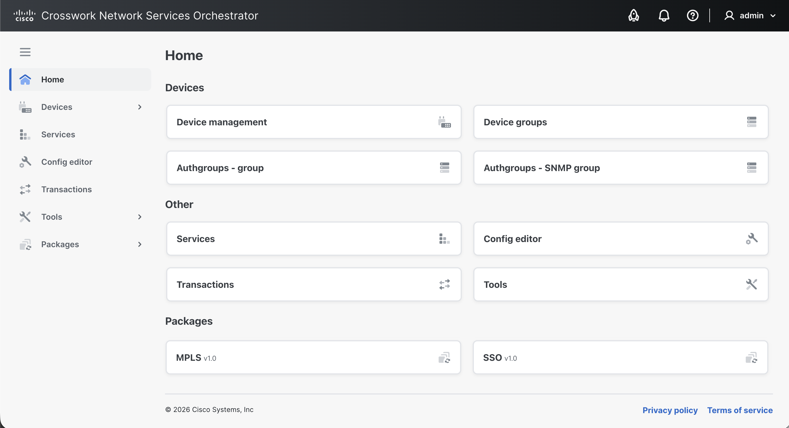

# Home

The **Home** view is the default view after logging in. It provides shortcuts to **Devices**, **Services**, **Config editor**, and **Tools**.

<figure><figcaption>
Home View
</figcaption></figure>

## Web UI Extension Packages

Loaded Web UI extension packages can add views to the **Packages** category in the sidebar. Links to these extension-package views are also shown in the **Home** view. The `webui-basic-example` package, supplied with the NSO examples, is an example Web UI extension package.

To upload, install, reload, or remove NSO packages, use **Tools > Packages**. For more information, see [Web UI Extension Packages](packages.md).
