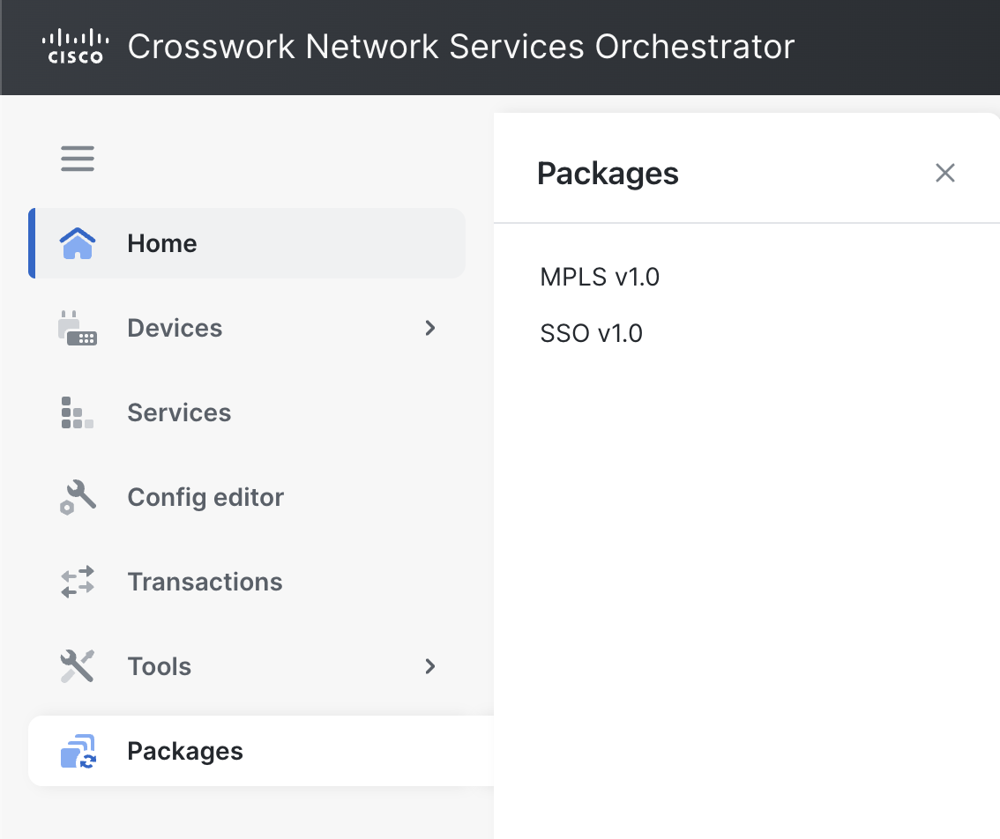

# Packages

Web UI extension packages add their own views to the NSO Web UI. Use the separate **Packages** category in the sidebar to open those views.

This category is different from **Tools** > **Packages**, which is used to upload, install, reload, and deinstall NSO packages. The `webui-basic-example` package, supplied with the NSO examples, is an example Web UI extension package.

<figure><figcaption>
Web UI Extension Packages Category
</figcaption></figure>

## Open an Extension Package View

The **Packages** category appears only when at least one loaded package provides a Web UI view. Expand the category and select a package to open its view.

If the category is not shown, no currently loaded package provides a Web UI view. Install, reload, or otherwise manage NSO packages from **Tools** > **Packages** as appropriate for your deployment.

The content and actions in an extension package view are defined by that package. The available actions can therefore vary with the package, its YANG model, the current data, and your access permissions.
