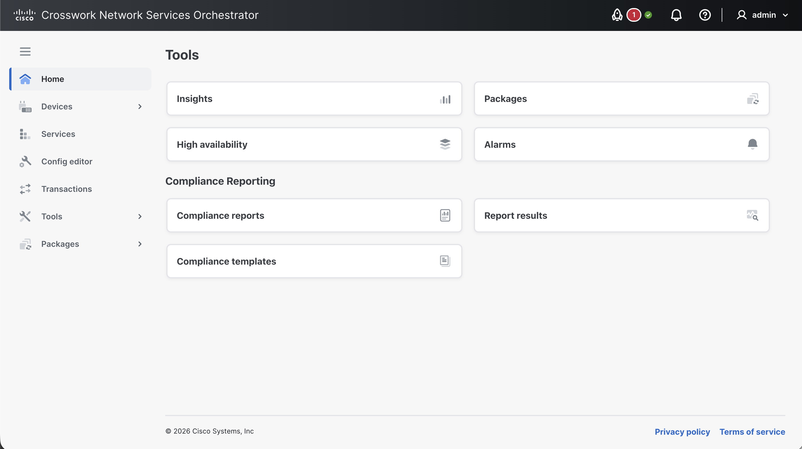
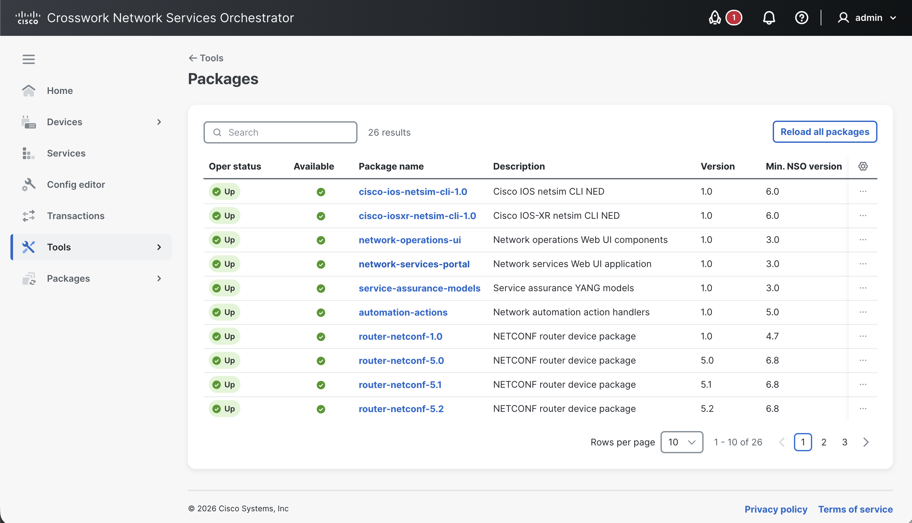
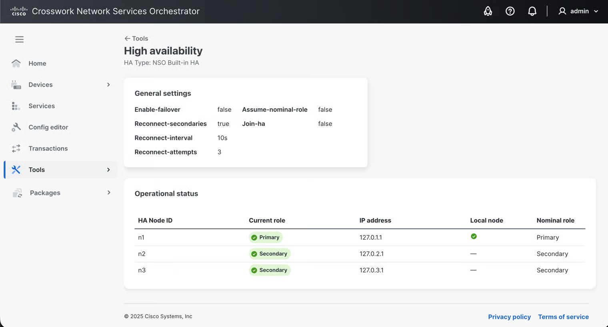
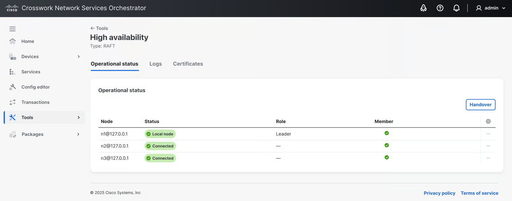
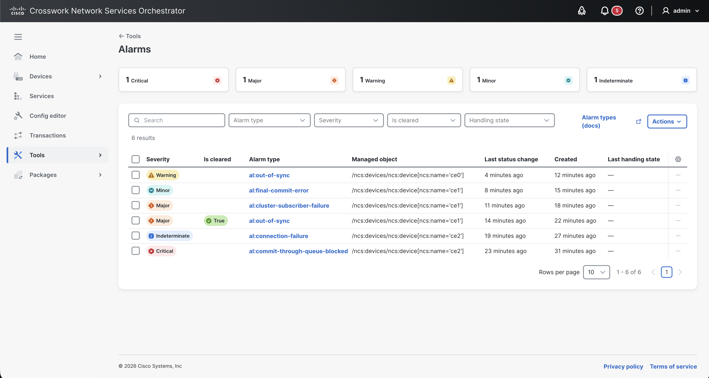
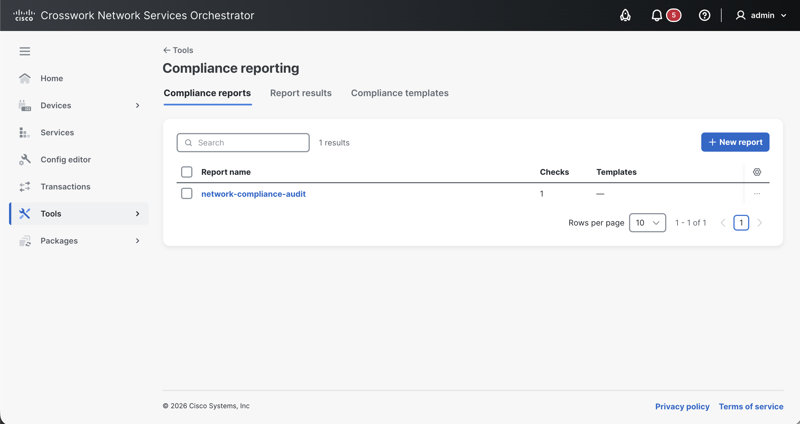
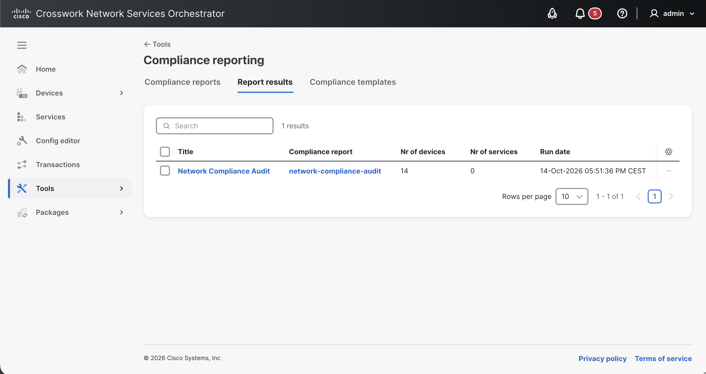
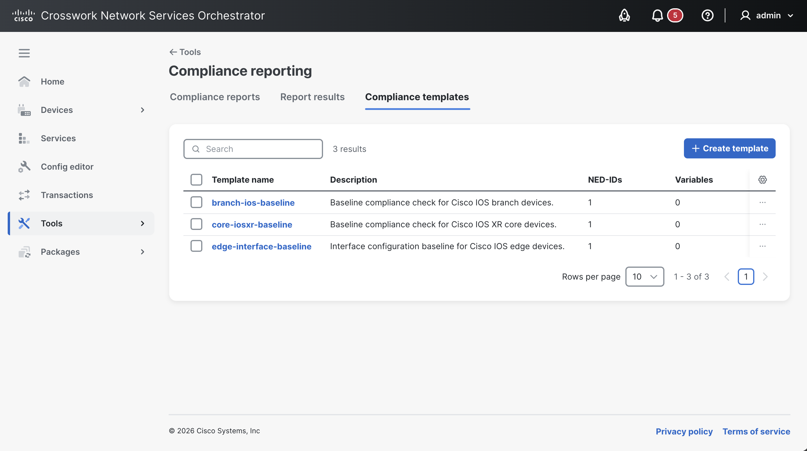

# Tools

The **Tools** view includes utilities that you can use to run specific tasks on your deployment.

<figure><figcaption>
Tools View
</figcaption></figure>

The following tools are available:

* [**Insights**](tools.md#d5e6470): Gathers and displays useful statistics of your deployment.
* [**Packages**](tools.md#d5e6487): Used to perform upgrades to the packages running in NSO.
* [**High availability**](tools.md#d5e6538): Used to manage a High Availability (HA) setup in your deployment.
* [**Alarms**](tools.md#d5e6565): Shows current alarms/events in your deployment and provides options to manage them.
* [**Compliance reporting**](tools.md#sec.webui_compliance): Used to run compliance checks on your NSO network.

Available actions in the **Packages**, **High availability**, **Alarms**, and **Compliance reporting** tools depend on the selected object's YANG schema and your access permissions. Therefore, the actions shown can vary by object, deployment, and current state.

## Insights 

The **Insights** view collects and displays the following types of operational information using the `/ncs:metrics` data model to present useful statistics:

* Real-time data about transactions, commit queues, and northbound sessions.
* Sessions created and closed towards northbound interfaces since the last restart (CLI, JSON-RPC, NETCONF, RESTCONF, SNMP).
* Transactions since the last restart (committed, aborted, and conflicting). You can select between the running and operational data stores.
* Devices and their sync statuses.
* CDB info about its size, compaction, etc.

## Packages 

In the **Packages** view, you can upload, install, and view the operational state of custom packages in NSO.

Package upload and installation require Package Upload to be enabled. In an HA deployment, the **Add package** action is available only on the primary node. The **Deinstall** action also requires Package Upload to be enabled and is shown only when it applies to the selected package.

<figure><figcaption>
Packages View
</figcaption></figure>

### Add a Package

Adding a new package via the Web UI entails uploading the package and then installing it. You can add multiple packages at once.

A package can be in one of the following states:

* **Up**: Package is installed and operational.
* **Not installed**: The package is uploaded but not installed.
* **Error**: Information that an error has occurred.

To add a new package:

1. Click the **Add package** button.
2. In the **Add package** dialog, browse the package using the **Add** button. The file format must be `.tar`, `.tar.gz`, or `.tgz`. You can add multiple packages at once.
3. Click **Upload**. A result is shown whether the operation was successful or not.
4. Once the upload has finished successfully, select the packages to install. If you want to replace an existing package with a new one, use the **Replace package if already exists** option, and to bypass or ignore version mismatches, use the **Allow NSO mismatch** option.
5. Click **Install**. A result is shown whether the operation was successful or not. For more details and troubleshooting the errors, see the trace output.
6. Perform a reload of packages if required. This can, for example, be if you uploaded and installed a new package version (e.g., Version 2.0) that subsequently requires a package reload to become operational. After running the package reload, the state of the package changes to **Up**.

### View Package Details

To view package details:

* Click the package name. This reveals information about the package, such as its status, version, location, etc. You can also uninstall a package in this view.

### Reload Packages

The reload action is the equivalent of the `packages reload` command in CLI and is used to load new/updated packages. If NSO is used in an HA or Raft setup, the `packages ha sync` action is invoked instead of the usual `packages reload` action, i.e., the packages will be synced in the cluster. Read more about the `reload` action in [NSO Packages](../operations/listing-packages.md) and for HA in [High Availability](../../administration/management/high-availability.md#packages-upgrades-in-raft-cluster). General package concepts are covered in [Package Management](../../administration/management/package-mgmt.md).

To reload the packages:

1. Click the **Reload all packages** button.
2. In the dialog, set the **Max wait time (sec)** for the commit queue to empty before proceeding with the reload. The default is 10 seconds if you leave the field unset.
3. Set the **Timeout action** behavior to define what happens after the maximum wait time is over, i.e., kill the open transactions and continue, or cancel (fail) the package reload operation altogether. The default for this setting is **fail**.
4. Apply additional action parameters from the following (optional): **Force** (to force package reload overriding issues or warnings), **Dry run** (to simulate the package reload process without making any actual changes), and **Wait commit queue empty** (to wait until the commit queue is empty before proceeding).
5. Click **Reload**. A live trace of the reload operation is displayed while the packages are being reloaded.
6. Click **Done** when the operation has finished.

### Deinstall a Package

To deinstall a package:

* Go to the package details view and click the **Deinstall** button, or use the more options  button in the packages list.

## High Availability 

The **High Availability** view is used to visualize your HA setup ([Rule-based](../../administration/management/high-availability.md#ug.ha.builtin) or [Raft](../../administration/management/high-availability.md#ug.ha.raft)). Depending on the type of HA configured (shown under the **High availability** title), the view displays available management options, current operational status, and actions for your cluster.

### Rule-based HA

The Rule-based HA view displays the general information and operational status of your cluster. Actions on the Rule-based cluster can be performed using the **Configuration editor** -> **Actions** tab.

Available Rule-based HA actions are described further under [Actions](../../administration/management/high-availability.md#d5e5031). Specific parameters and field definitions shown in the view are covered in detail in the rest of the [HA documentation](../../administration/management/high-availability.md).

An example cluster of a Rule-based HA setup is shown below.

<figure><figcaption>
High Availability View (Rule-based)
</figcaption></figure>

### Raft HA

The Raft HA view displays overview of your cluster and provides options to manage them.

Available Raft HA actions are described further under [Actions](../../administration/management/high-availability.md#ch_ha.raft_actions), and can be run directly in the Web UI. Specific parameters and field definitions shown in the view are covered in detail in the rest of the [HA documentation](../../administration/management/high-availability.md).

<figure><figcaption>
High Availability View (Raft)
</figcaption></figure>

#### Handover Cluster Leadership 

The **Handover** option allows you to hand over the leadership of your Raft cluster to another node.

Perform the handover as follows:

1. Click the **Handover** button.
2. Select the new leader from the list.
3. Click **Save**. A message is shown if the handover was successful or not.

#### Actions on a Node

Actions on a node, such as **Add node**, **Remove node**, **Disconnect**, etc., are available by accessing the more options  button on a node. Most of the actions in Raft HA can only be executed from the leader node.

#### Logs and Certificates

The **Logs** and **Certificates** tabs provide detailed insights into the state and configuration of the Raft cluster.

* **Logs** tab: Provides detailed logs pertaining to Raft operation and displays information about the internal RAFT replication process and its operational status. This includes the synchronization state of configuration data across HA nodes.
  *   **Log status** – Summarizes the current state of the RAFT log on this node:

      * **Current index**: The index of the latest log entry stored on the node.
        * **Applied index**: The index of the latest log entry that has been committed and applied to the system’s state machine.
        * **Num entries**: The total number of log entries currently held by the node.

      When all three values are equal (for example, 27), it indicates that the node is fully synchronized and up to date with the cluster leader.
* **Certificates** tab: Lists the SSL/TLS certificates used for secure communication between nodes in the HA cluster. This ensures encrypted and authenticated synchronization of data across the RAFT network.

## Alarms 

The **Alarms** view displays alerts in the system for your NSO-managed objects and provides options to manage them.

<figure><figcaption>
Alarms View
</figcaption></figure>

An alarm is raised when an NSO object undergoes a state change that requires attention. The alarms, depending on their severity, are categorized as **Critical**, **Major**, **Minor**, **Warning**, and **Indeterminate**. Detailed alarm management concepts are covered in [Alarm Manager](../operations/alarm-manager.md) and different alarm types are described in [Alarm Types](../../administration/management/system-management/alarms.md).

### Viewing Options

You can search and sort the alarm list to display alarm results according to your need.

* To search for an alarm against an object, search for the object name (e.g., device name).
* To sort the alarms list, use one of the specified criteria from **Alarm type** , **Severity**, **Is cleared**, or **Handling state**.

**Alarm Details**

Individual alarm details are accessible by clicking the severity level icon on an alarm. This brings up the alarm's details, its status (severity) changes, and historical handling information.

### Alarm Actions

Depending on your NSO configuration and permissions, the **Actions** menu provides the following root-level and per-alarm actions:

* The **Synchronize** action compares the NSO alarm list with the alarm state reported by managed resources. It reports the number of new, changed, and cleared alarms. Its result depends on the device or NETCONF server alarm-reporting support.
* The **Compress** action streamlines the alarm entries by deleting the historical state changes that occurred before the last one. It keeps the latest state change and the alarm entries intact.
* The **Filter** action returns the keys of alarms that match the specified status and optional age, severity, or handling-state criteria. It displays the results in the action drawer and does not change the filters applied to the alarm table.
* The **Purge** action completely removes the alarm entries according to the specified criteria.

To use an action, select it from **Actions**, provide any required input, and click **Run** in the action drawer.

The more options  menu for an individual alarm can provide **Compress**, **Purge**, and **Handle alarm**. **Compress** and **Purge** affect only that alarm. **Handle alarm** is described in the next section.

### Alarm Handling

Alarm handling refers to attending to an alarm. This usually entails reviewing the alarm and setting a state on it, for example, **Acknowledged**. Historical handling state changes are accessible in alarm details.

You can set the handling state in either of the following ways:

* **For one or more selected alarms**: Select the alarm rows, click **Set alarm handling state**, choose **None**, **Acknowledged**, **Investigation**, **Observation**, or **Closed**, and optionally enter a description. Click **Set state** to apply the selected state to every selected alarm.
* **For one alarm**: In the alarm row, click more options  and select **Handle alarm**. This opens the action drawer for that alarm. Provide the available action inputs and click **Run**. The inputs depend on the alarm action schema and your permissions.

After either action completes successfully, the state change is recorded on the **Alarm handling** tab in the alarm details.

## Compliance Reporting 

The **Compliance reporting** view is used to create and run compliance reports to check the current situation, check historical events, or both. The conceptual aspects of the compliance reporting feature are discussed in greater depth in the [Compliance Reports](../operations/compliance-reporting.md) section.


Web UI is the recommended way of running the compliance reports.


The following tabs are available in this view:

* **Compliance reports**
* **Report results**
* **Compliance templates**

### Compliance Reports

The **Compliance reports** tab is used to view, create, run, and manage the existing compliance reports.

<figure><figcaption>
Compliance Reports View
</figcaption></figure>

#### **Create a Compliance Report**

To create a new compliance report:

1. In the **Compliance reporting** view -> **Compliance reports** tab, click **New report**.
2. In the **Create new report** pop-up, enter the report name and click **Create**.
3. Next, set up the compliance report using the following tabs. For a more detailed description of Compliance Reporting concepts and related configuration options, see [Compliance Reporting](../operations/compliance-reporting.md).
   * **General** tab: To configure the report name. Configuration options include:
     * **Report name**: Displays the report name and allows editing of the report name.
     * **Common-db**: Controls how NSO stores generated report results. When set to **True** (the default), NSO stores each result as a new record in a common database file. When set to **False**, NSO stores each result in a separate database file. Historic compliance is available only when this option is set to **True**.
   * **Devices** tab: To configure device compliance checks. Configuration options include:
     * **Device choice**: Include **All devices** or only **Some devices** to include in compliance checks. If **Some devices** is selected, specify the devices using a device group, an XPath expression, or individual devices.
     * **Device checks**:
       * **Current out of sync**: Check the device's current status and report if the device is in sync or out of sync. Possible values are **true** (yes, request a check-sync) and **false** (no, do not request a check-sync).
       * **Historic changes**: Include or exclude previous changes to devices using the commit log. Possible values are **true** (yes, include) and **false** (no, exclude).
     * **Compliance templates**: If a compliance template should be used to check for compliance (see [Device Configuration Checks](../operations/compliance-reporting.md#device-configuration-checks)). You have the option to add a compliance template using the **Add template** button or create a new compliance template (see [Compliance Templates](tools.md#compliance-templates)). To enforce devices to comply exactly with the template's configuration, use **Strict** mode; see [Additional Configuration Checks](../operations/compliance-reporting.md#additional-configuration-checks) for more information.
     * The **Devices** tab also provides separate lists for **Compliance templates (XML)** and **Device templates**. Use the corresponding **Add XML template** or **Add device template** action to include those templates in the report. For information about XML compliance templates, see [XML Compliance Templates](../operations/compliance-reporting.md#xml-compliance-templates).
     * After adding a device template or XML template, use **Edit template** to configure its variables and whether **Strict** matching is enabled.
   * **Services** tab: To configure service compliance checks. Configuration options include:
     * **Service choice**: Include **All services** or only **Some services**. If **Some services** is selected, specify the services using service type, an XPath expression, or individual service instances.
     * **Service checks**:
       * **Current out of sync**: Check the service's current status and report if the service is in sync or out of sync. Possible values are **true** (yes, request a check-sync) and **false** (no, do not request a check-sync).
       * **Historic changes**: Include or exclude previous changes to services using the commit log. Possible values are **true** (yes, include) and **false** (no, exclude).
4. Click **Create report** when the report setup is complete. The changes are saved and applied immediately.


In the **Compliance reports** tab, you can apply the following actions on the report by selecting it using the checkbox and using the more options  button.

* **Copy as new report**: Copy an existing report as a new report.
* **Run**: Run the report.
* **Delete**: Delete the report.
* **Edit name**: Edit the report name.


#### **Run a Compliance Report**

To run a compliance report:

1. In the **Compliance reports** tab, click the desired report.
2. On the report details page, click the **Actions** button and select **Run**.
3. In the **Run** action drawer, optionally provide a title for the report result and a historical time interval using **from** and **to** fields. If you do not specify a time interval, the report uses the maximum available interval. Choose an output format using the **diff-outformat** option.
4. Click **Run**.

### Report Results

The **Reports results** tab is used to view the status and results of the compliance reports that have been run.

<figure><figcaption>
Reports Results View
</figcaption></figure>

#### View Compliance Report Results

The report's results show if the devices/services included in the report are compliant/in-sync or have violations. A summary of the report status is readily available in the **Report results** tab. To fetch detailed information on the report, click the report name. The following information panes are then available:

* **Details**: Includes specifics about the report that was run, such as report name, date/time it was run, time range, and contents analyzed (i.e., services, devices, and rollback files).
* **Results overview**: Shows a summary of results with visuals on the number of devices and services that are presently compliant/in-sync.
* **Historic compliance**: Shows a history of compliance (in percentages) for the devices and services that were included in the report run. The graph is presented based on the previous report runs and you can narrow down the graph to show data from specific periods (e.g., last 10 runs only). Predefined time ranges include last 30 days, last month, last 6 months, and last year, whereas custom time ranges allow users to define their own time ranges. The default preset is set to last 30 days.
* **Devices**/**Services**/**Errors**: Displays individual compliance and error information for analyzed devices and services. In case of non-compliance, a 'diff view' is available. When an XML template has failed assertions, its result includes a **Failed assertions** section with assertion location, context, and message details.

Use **Rerun** in a report result to run the report again. Select **Rerun all** to rerun the full report, or **Rerun non-compliant** to rerun only the devices and services that were non-compliant in that result. **Rerun non-compliant** is unavailable when the result is compliant. Either selection opens an action drawer; provide any required inputs and click **Run**.


Use the **Export to file** button to export the report results to a downloadable file (PDF).


### Compliance Templates

The **Compliance Templates** tab is used to create new compliance templates and manage existing ones.

<figure><figcaption>
Compliance Templates View
</figcaption></figure>

There are two ways to create a compliance template:

* **From device template**: Build a new template from an existing predefined device template.
* **From config**: Build a new template directly from an existing device configuration.


**Create a Template in the Config Editor**

Alternatively, create a CDB compliance template manually in the Config Editor. Create a template under `/compliance/template`, add a `ned-id` entry for a loaded NED, and define the expected device configuration in its `config` subtree. This option is intended for users familiar with the relevant YANG model and NED.




Use this option to base your new template on an existing [device template](../operations/basic-operations.md#d5e228).

To create a compliance template from a device template:

1. In the **Compliance templates** tab, click **Create template**.
2. In the **Create template** drawer, continue with the default option, **From device template**.
3. Choose a device template. A device template must exist before you can select it. If the template supports more than one NED ID, also select the NED ID to use.
4. Optionally, provide a name for the compliance template. Leaving it blank retains the device template name.
5. Optionally, set **out-directory** to write the generated XML template to a directory instead of adding it to the NSO configuration.
6. Click **Run**.



Use this option to build a new template from configuration.

To create a compliance template from config:

1. In the **Compliance templates** tab, click **Create template**.
2. In the **Create template** drawer, select **From config**.
3. Provide a **name** that will be used to reference the template in NSO.
4. Choose one source for the configuration:
   * **config-path**: In the **Path** field, enter one or more XPath paths below `/devices/device/config`, clicking **Add item** after each path. Paths outside this subtree are ignored. Use **Match rate** to specify the required recurrence between the device configurations; **100** (the default) requires common structure across all source devices, while a lower value permits partial commonality. Optionally enable **Exclude service config** to omit configuration already managed by services.
   * **config-data**: Create a template from configuration supplied directly. Select the format—XML, Cisco XR CLI, Juniper curly-brace CLI, or Juniper set commands—then choose **file** to specify a file on the NSO host or **data** to enter the configuration. Select the required **ned-id** for the configuration.
5. **Regex induction**: Select the method used when values differ across the selected source devices. **trie** is the default, **dfa** also factors common suffixes, and **none** uses a generic match-all expression.
6. **Collapse list keys**: Enable this option to determine how lists in the XPath configuration are collapsed into single entries when keys do not match. The options in this category are:
   * **Automatic**: Automatically find non-matching lists to collapse. Lists on the same path in `/devices/device/config` that do not compare equal will be collapsed.
   * **All**: All list keys are collapsed into a single entry, regardless of matching rules.
   * **List path**: Use a user-provided list of paths to collapse. Allows manual control.
   * **Disabled**: Disable list collapsing entirely, displaying all list entries and differences in full detail.
7. Optionally, set **out-directory** to write the generated XML template to a directory instead of adding it to the NSO configuration.
8. Click **Run**.



When `out-directory` creates an XML compliance template, reload the XML templates before selecting the generated template in a compliance report or using it for a check.
