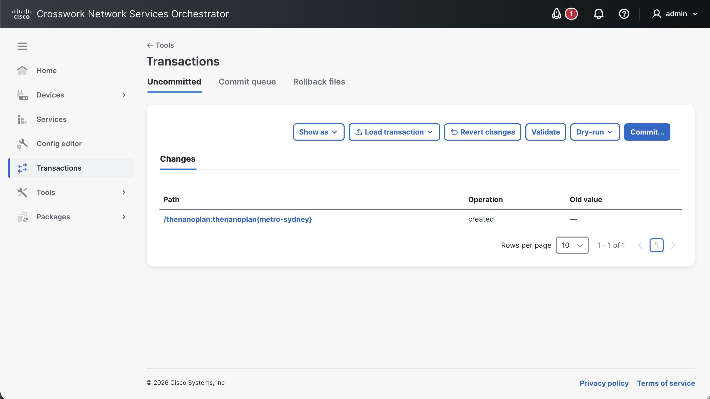

# Transactions

The **Transactions** view lets you view and manage current NSO transactions. It provides a centralized way to inspect and manage configuration changes in your NSO deployment. You can review uncommitted changes, monitor commit queue activity, validate or revert active changes, and work with rollback files.

Select a path in the changes, errors, or warnings table to open that location in the **Config editor**, when a link is available.

<figure><figcaption></figcaption></figure>

The Web UI also warns when it detects multiple webui-one write transactions. This can happen when a transaction is created outside the Web UI’s normal workflow, for example by a custom package. The Web UI may not work as expected because it cannot determine which transaction to use.

The **Transactions** view is further divided into the following tabs:

* **Uncommitted**: Shows the changes currently present in the active transaction and provides options to view them in a selected format, load, validate, or revert them.
* **Commit queue**: Displays queued commit operations and their status.
* **Rollback files**: Lists rollback files created for committed changes so that earlier transactions can be inspected or undone.

## Review Transaction Changes from Any Web UI View

When the current browser session has uncommitted changes, select the **Changes** indicator () in the Web UI header to open the transaction menu. From this menu, you can validate, commit, revert, or preview the current transaction without leaving the view you are working in.

Select **Dry-run**, then choose an output format to preview the pending changes before committing them. For **Juniper curly-bracket outformat**, use **Raw diff** or **Side-by-side diff**. The side-by-side view uses color to distinguish changes.

## Uncommitted Changes

The **Uncommitted** tab shows the configuration changes currently made in NSO but not yet committed. The changes are presented with their path, operation, old value, and new value.

From this view, you can review the active transaction before committing it.

When the Web UI is open in multiple browser tabs, local session transactions are synchronized across those tabs. Synchronization includes transaction creation, modifications, reversion, and commit. Updates made in one tab are reflected in the others.

When more than one transaction tag is available, use the **Transaction tags** selector to choose which transaction to view. The tag used by the Configuration editor is displayed as **webui-one (default tag, config editor)**.

### Validate Changes

Use **Validate** to verify the current transaction before committing it. Validation helps detect issues in the pending configuration so they can be corrected before the changes are applied.

### Revert Changes

Use **Revert changes** to discard the current uncommitted transaction. This removes the pending changes from the active transaction.

### Show Transaction Changes

Use **Show as** to view the current uncommitted changes in one of the following formats:

* XML
* Cisco XR CLI
* Juniper curly-brace CLI

The drawer lets you copy the displayed changes or save them to a file. **Show as** replaces the earlier **Export transaction** drawer. To preview changes without committing them, select **Dry-run** and choose **Cisco XR CLI outformat**, **Juniper curly-bracket outformat**, **XML outformat**, or **Device native outformat**. The result opens in a drawer. For a Juniper curly-bracket dry run, use **Raw diff** or **Side-by-side diff** to view the result. The side-by-side diff uses color to distinguish changes. You can also configure a dry-run in the **Commit** drawer.

### Load Transaction

Use **Load transaction** to load configuration data into the current transaction. This can be used to continue working with previously saved changes or to import changes from another source. Options include:

* **Use** **File**: Use a file from your local disk.
* **Use** **Data**: Paste in the configuration data.

The supported input formats are **XML**, **JSON**, **Cisco XR CLI**, **Juniper curly-brace CLI**, and **Juniper CLI commands**. Select **Merge**, **Create**, or **Replace** to choose how the loaded configuration is applied to the current transaction. **Create** is available for XML and JSON input; for Cisco XR CLI, Juniper curly-brace CLI, and Juniper CLI commands, use **Merge** or **Replace**.

### Resolve a Non-resolvable Transaction State

If the Commit drawer reports that a transaction is in a non-resolvable state, the dialog shows the conflict message and provides **Show changes** and **Reapply**. Use **Show changes** to review the pending changes. **Reapply** attempts to apply the transaction operations again; if it fails, the dialog displays the error.

## Commit Queue

The **Commit queue** tab displays configuration changes that have been committed to NSO and queued for delivery to devices. Use this tab to monitor queued operations and their progress.

This tab is divided into the following subtabs:

* **Queue**: Displays commit queue items that are waiting to be processed or are currently being processed.
* **Completed**: Displays commit queue items that have finished processing and are kept as completed results.

For more information about commit queue behavior, see [Commit Queue](../operations/nso-device-manager.md#user_guide.devicemanager.commit-queue).

### Queue

The **Queue** subtab displays commit queue entries that are pending or in progress. Use this subtab to monitor queued operations and their progress before they complete.

### Completed

The **Completed** subtab displays commit queue entries that have finished processing. This view can be used to review previously-processed queue items and their associated result information.

The completed results list includes the following information:

* **Status**: The final status of the completed queue item.
* **ID**: The identifier assigned to the queue item.
* **Label**: The label associated with the queue item, if available.
* **Devices**: The devices affected by the queue item.
* **Services**: The services affected by the queue item.
* **Date**: The date and time when the result was recorded.

You can search the completed results list by using the **Search** field.

Open a completed result to inspect its details, including completed and failed services when available.

A completed result can provide additional actions through its more-options menu. Available actions depend on the result schema and your access permissions. When available, use **Apply rollback** to open the rollback action drawer.

#### Purge Completed Results

Use **Purge** in the **Completed** subtab to remove completed commit results from the list. This action is useful when you want to clean up historical commit queue results that are no longer needed for review.

When you click **Purge**, the **Purge completed queue items** dialog is displayed. In this dialog, you can specify which queue items to remove. Options include:

* **status**: Select the result status of the queue items to purge. Available values are **completed**, **deleted**, and **failed**.
* **older-than**: Purge items older than specified seconds, minutes, hours, days, or weeks. The time fields can be used to define the age of queue items that should be removed.

To purge completed queue items:

1. Open the **Commit queue** tab and select the **Completed** subtab.
2. Click **Purge**.
3. In the **Purge completed queue items** dialog, specify the desired **status** and age criteria.
4. Click **Run**.

Use **Close** to exit the dialog without removing any completed queue items.

## Rollback Files

The **Rollback files** tab lists rollback files generated by NSO for committed transactions. These files can be used to inspect earlier changes and, when needed, restore configuration to a previous state.

Rollback files provide a convenient way to undo network-wide configuration changes after they have been committed.

To apply a rollback file, open it to review the rollback diff and select **Apply**. Complete the required action parameters in the **Apply rollback** drawer, then select **Run**.

Applying a rollback does not commit it automatically; review and commit the resulting transaction when ready.
